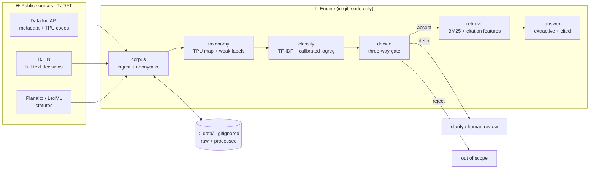
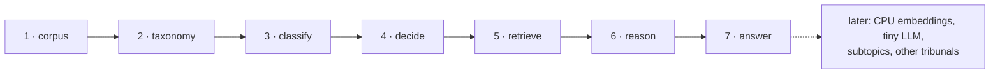

# ⚖️ agavus

**CPU-only legal intelligence for Brazilian law** — classification + cited
retrieval, no GPU, no Node. Built on a domain-organized Python scaffold with
strict, machine-enforced quality gates.


> Status: **design complete, implementation not started.**
> Full design: **[docs/DESIGN.md](docs/DESIGN.md)**

## 🎯 Vision

A legal **classifier + search/answer engine** restricted, for now, to **TJDFT**
data and two routing domains:

| Code | Domain | Examples |
| :--: | ------------------------------------ | ---------------------------------------------- |
| **F** | Direito de família | divórcio, guarda, alimentos, união estável |
| **M** | Maria da Penha / violência doméstica | medidas protetivas **and** DV criminal prosecutions (lesão corporal, ameaça, feminicídio, art. 24-A) |

General criminal law is **out of scope** — M absorbs the whole domestic-violence
picture, both its civil and criminal facets.

Answers are **cited excerpts from statutes and decisions — never generated
opinions**. When uncertain, the system *defers*; it does not guess.

## 🏗️ Architecture



Key ideas:

- 🧮 **Mathematical core, CPU-trainable**: TF-IDF + calibrated logistic
  regression; BM25 + statute-citation features. Small CPU embeddings and a
  quantized CPU LLM are optional later layers — never the source of truth.
- 🏷️ **Free labels**: CNJ TPU taxonomy + DataJud metadata; TJDFT specialized
  varas as weak labels.
- 🔀 **Routing taxonomy, not legal branches**: Maria da Penha is a hybrid
  statute (penal + civil/família); M↔F overlap is expected and handled by the
  boundary region, with multi-label as a documented evolution path.
- 🔒 **Corpus never in git** (public repo + LGPD): real data lives in a
  gitignored `data/` dir (`AGAVUS_DATA_DIR`); the repo holds only code,
  schema, taxonomy tables, and synthetic fixtures.
- 🧩 **Extensible by design**: new areas (trabalhista, bancário, …) are
  *data packs*, not code changes — registry + namespaced corpus + composed
  loss matrix, with a shadow-mode activation gate. See
  [docs/extensibility.md](docs/extensibility.md).
- 🧠 **Reasoning as verified chains**: symbolic syllogism + requirements
  checklists + citation graph; an optional tiny CPU LLM may *propose*, but
  the engine *verifies* — verified or discarded. See
  [docs/reasoning.md](docs/reasoning.md) and
  [docs/tiny-llm.md](docs/tiny-llm.md).
- 📏 **Eval-gated quality**: versioned gold sets, hard safety targets
  (M recall, citation correctness, zero leakage), ablations per mitigation,
  regression-blocking reports. LoRA is an eval-triggered investment, not a
  plan. See [docs/evals.md](docs/evals.md).

## 🔀 Three-way decisions

Cost-sensitive accept / reject / defer (Yao's decision-theoretic rough sets).
Safety-critical errors are priced highest — e.g. misrouting Maria da Penha as
ordinary family law (loss 10) or silently dropping it (loss 8).


| Domain | α (accept ≥) | β (reject ≤) | Behavior |
| -------------- | :----------: | :----------: | ------------------------------------- |
| Família | ~0.89 | ~0.25 | strictest acceptance (M→F catastrophic) |
| Maria da Penha | ~0.86 | **~0.12** | hardest to reject; weak signals defer |

## 🗺️ Roadmap



## 🚀 Quickstart

Requirements: Python >= 3.12 and [uv](https://docs.astral.sh/uv/).

```sh
make install        # uv sync --extra dev + install pre-commit hooks
cp .env.example .env
make check          # all quality gates + tests
uv run agavus       # -> Hello, world!
AGAVUS_NAME=Brasil uv run agavus   # -> Hello, Brasil!
```

Planned product CLI (contract in [docs/cli.md](docs/cli.md)):

```sh
agavus -p "Qual é o artigo da lei de alienação parental?"
# → cited excerpt of Lei 12.318/2010, art. 2º + source + disclaimer
agavus classify --file peticao.txt --explain
```

Available today (corpus phase):

```sh
uv run agavus ingest --source datajud --limit 500   # TJDFT metadata → data/
uv run agavus ingest --source statutes              # Planalto articles → data/
```

Every commit runs all gates via **pre-commit** (local hooks through `uv`).
Run them manually with `make hooks`.

## 🛠️ Commands

| Command            | What it does                                            |
| ------------------ | ------------------------------------------------------- |
| `make lint`        | Ruff lint + format check                                |
| `make format`      | Ruff auto-format + lint autofix                         |
| `make typecheck`   | mypy `--strict` (all inputs/outputs typed, no `Any`)    |
| `make dupcheck`    | Token-based clone detector — zero tolerance             |
| `make depcheck`    | deptry — fails on unused/missing dependencies           |
| `make sizes`       | Custom checker: function/file size limits               |
| `make test`        | pytest (tests in per-domain `tests/` folders)           |
| `make check`       | Everything above, in order                              |
| `make hooks`       | pre-commit against all files                            |

## 📁 Structure (by domain)

```
docs/
  DESIGN.md              # architecture, data, models, loss matrix, evaluation
  math/                  # one doc per formula, with worked examples
  corpus/                # deep-dive: range (2020→today), sources, schema, LGPD
  extensibility.md       # new areas (trabalhista, bancário…) as data packs
  cli.md                 # usage contract: agavus -p, classify, --explain
  reasoning.md           # verified chains: syllogism, checklists, citation graph
  tiny-llm.md            # optional CPU LLM: proposer behind a verifier
  evals.md               # gold sets, benchmarks, regression gates, LoRA triggers
  response-quality.md    # delivery contract: checklist, degradation ladder
  publishing.md          # HF model repo + Space, eval-gated, LGPD-bound
  external-validation.md # Jev comparator pilot: protocol, results, caveats
src/agavus/
  __main__.py            # CLI entry point (delegates to cli.py)
  cli.py                 # greeting + `ingest` subcommand
  tests/                 # tests for root-level modules
  config/                # configuration domain (isolated, env-driven)
    settings.py
    tests/               # settings_test.py
  greeting/              # greeting domain (hello world)
    greet.py
    tests/
  corpus/                # ingestion: records, storage, fetch, datajud, statutes…
    tests/               # one <module>_test.py per module
  taxonomy/              # area registry (F/M/O); TPU mapping next
    tests/
  classify/              # placeholders — TF-IDF + calibrated logreg
  decide/                #   three-way decision gates
  retrieve/              #   BM25 + citations
  reason/                #   verified chains (syllogism, rules, graph)
  answer/                #   extractive, cited answers
  evals/                 #   gold sets + benchmark harness (cross-cutting)
scripts/
  pyutils.py             # shared tokenization helpers for quality scripts
  check_sizes.py         # size-limit enforcement
  check_duplication.py   # copy-paste detection (jscpd replacement)
  check_commit_msg.py    # commit convention gate
  check_staged_data.py   # LGPD guard: no corpus data in git
  tests/                 # one <module>_test.py per script
```

New domains (`classify`, `decide`, `retrieve`, `answer`) follow the same
pattern: module + `tests/<module>_test.py`.

## ⚙️ Configuration

Isolated in `agavus.config.settings`: a frozen, fully typed `Settings`
dataclass loaded from `.env` and environment variables. Copy `.env.example`
to `.env`; never commit `.env`.

| Variable      | Default | Meaning              |
| ------------- | ------- | -------------------- |
| `AGAVUS_NAME` | `world` | Name used in greeting |

Planned (see design doc): `AGAVUS_DATA_DIR` for the gitignored corpus location.

## 📏 Conventions (enforced, not optional)

- **2 spaces** indentation everywhere (`.editorconfig`, Ruff). Makefile recipes
  are the sole exception — Make requires literal tabs.
- **Strict types**: mypy `strict = true`; every function has annotated inputs
  and outputs; no untyped defs, no `Any`.
- **Function <= 80 code lines**, **file <= 500 code lines** (comments and blank
  lines excluded) — enforced by `scripts/check_sizes.py`.
- **No duplication**: `scripts/check_duplication.py` fails on any shared run of
  >= 30 tokens (comments/whitespace ignored), within or across files.
- **No unused dependencies**: deptry checks imports against `pyproject.toml`.
  (knip is JavaScript-only; deptry is its Python equivalent.)
- **Tests in per-domain `tests/` folders**: `corpus/tests/storage_test.py`,
  `scripts/tests/…` for tooling; naming stays `<module>_test.py`.
- **Domain-first layout**: group by business domain, not by technical layer.
- **All gates run on every commit** via pre-commit local hooks.
- **Commits are semantic and concise** (`type(scope): subject`, body only
  when needed) — the project's decision memory. See `docs/commits.md`.
- **No real case data in git, ever** — synthetic fixtures only; corpus lives
  outside the repo (LGPD).

## 🧰 Tooling notes

- Everything runs through `uv`; pre-commit hooks are `repo: local` with
  `language: system`, so no Node and no extra hook environments are needed.
- `uv.lock` is committed for reproducible installs.