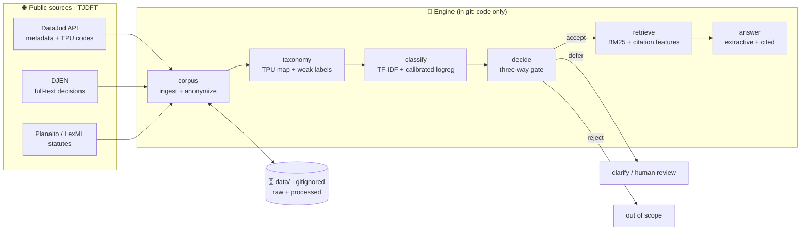
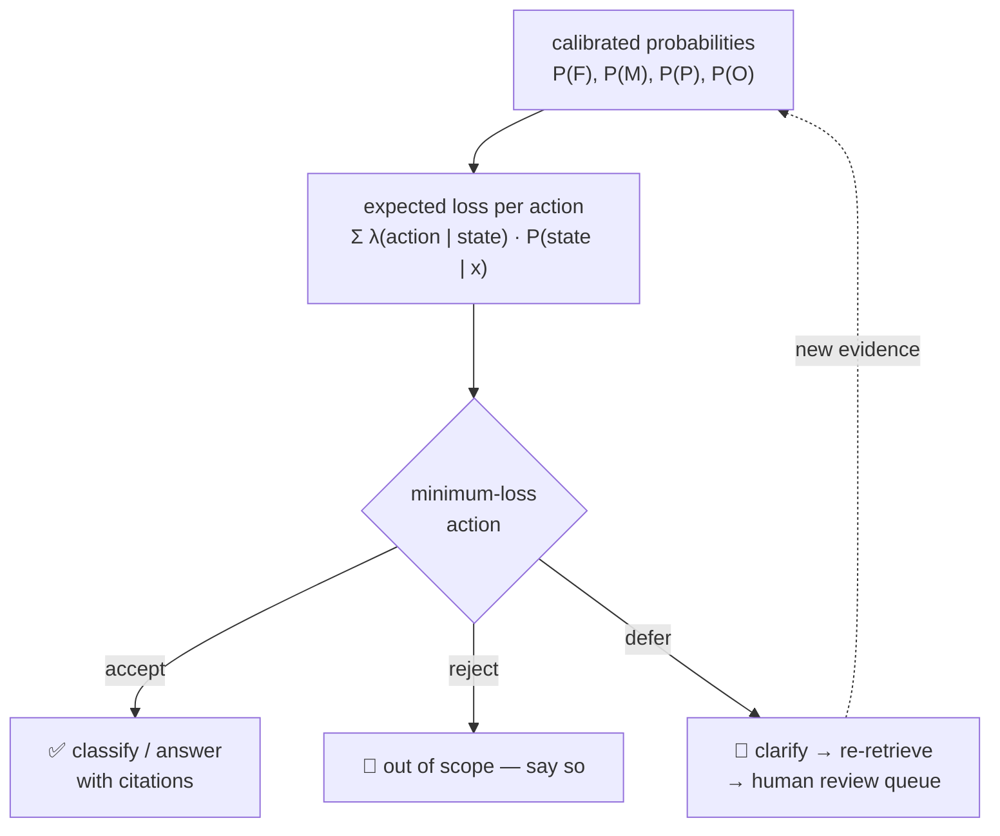
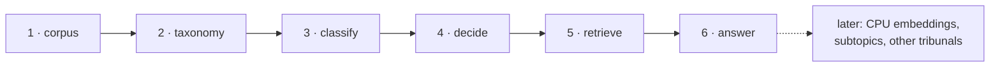

# ⚖️ agavus

**CPU-only legal intelligence for Brazilian law** — classification + cited
retrieval, no GPU, no Node. Built on a domain-organized Python scaffold with
strict, machine-enforced quality gates.


> Status: **design complete, implementation not started.**
> Full design: **[docs/DESIGN.md](docs/DESIGN.md)**

## 🎯 Vision

A legal **classifier + search/answer engine** restricted, for now, to **TJDFT**
data and three routing domains:

| Code | Domain | Examples |
| :--: | ------------------ | ---------------------------------------------- |
| **F** | Direito de família | divórcio, guarda, alimentos, união estável |
| **M** | Maria da Penha | Lei 11.340/2006, medidas protetivas |
| **P** | Direito penal | crimes em geral, dosimetria, execução penal |

Answers are **cited excerpts from statutes and decisions — never generated
opinions**. When uncertain, the system *defers*; it does not guess.

## 🏗️ Architecture



Key ideas:

- 🧮 **Mathematical core, CPU-trainable**: TF-IDF + calibrated logistic
  regression; BM25 + statute-citation features. Small CPU embeddings and a
  quantized CPU LLM are optional later layers — never the source of truth.
- 🏷️ **Free labels**: CNJ TPU taxonomy + DataJud metadata; TJDFT specialized
  varas as weak labels.
- 🔀 **Routing taxonomy, not legal branches**: Maria da Penha is a hybrid
  statute (penal + civil/família); M↔F overlap is expected and handled by the
  boundary region, with multi-label as a documented evolution path.
- 🔒 **Corpus never in git** (public repo + LGPD): real data lives in a
  gitignored `data/` dir (`AGAVUS_DATA_DIR`); the repo holds only code,
  schema, taxonomy tables, and synthetic fixtures.

## 🔀 Three-way decisions

Cost-sensitive accept / reject / defer (Yao's decision-theoretic rough sets).
Safety-critical errors are priced highest — e.g. misrouting Maria da Penha as
ordinary family law (loss 10) or silently dropping it (loss 8).



| Domain | α (accept ≥) | β (reject ≤) | Behavior |
| -------------- | :----------: | :----------: | ------------------------------------- |
| Família | ~0.86 | ~0.25 | strictest acceptance (M→F catastrophic) |
| Maria da Penha | ~0.80 | **~0.12** | hardest to reject; weak signals defer |
| Penal | ~0.80 | ~0.25 | balanced |

## 🗺️ Roadmap



## 🚀 Quickstart

Requirements: Python >= 3.12 and [uv](https://docs.astral.sh/uv/).

```sh
make install        # uv sync --extra dev + install pre-commit hooks
cp .env.example .env
make check          # all quality gates + tests
uv run agavus       # -> Hello, world!
AGAVUS_NAME=Brasil uv run agavus   # -> Hello, Brasil!
```

Every commit runs all gates via **pre-commit** (local hooks through `uv`).
Run them manually with `make hooks`.

## 🛠️ Commands

| Command            | What it does                                            |
| ------------------ | ------------------------------------------------------- |
| `make lint`        | Ruff lint + format check                                |
| `make format`      | Ruff auto-format + lint autofix                         |
| `make typecheck`   | mypy `--strict` (all inputs/outputs typed, no `Any`)    |
| `make dupcheck`    | Token-based clone detector — zero tolerance             |
| `make depcheck`    | deptry — fails on unused/missing dependencies           |
| `make sizes`       | Custom checker: function/file size limits               |
| `make test`        | pytest (tests are co-located with sources)              |
| `make check`       | Everything above, in order                              |
| `make hooks`       | pre-commit against all files                            |

## 📁 Structure (by domain)

```
docs/
  DESIGN.md              # architecture, data, models, loss matrix, evaluation
src/agavus/
  __main__.py            # CLI entry point
  config/                # configuration domain (isolated, env-driven)
    settings.py
    settings_test.py     # tests live next to the code they test
  greeting/              # greeting domain (hello world)
    greet.py
    greet_test.py
  corpus/                # placeholders — design complete, no implementation yet
  taxonomy/              #   TPU mapping + weak labels
  classify/              #   TF-IDF + calibrated logreg
  decide/                #   three-way decision gates
  retrieve/              #   BM25 + citations
  answer/                #   extractive, cited answers
scripts/
  pyutils.py             # shared tokenization helpers for quality scripts
  check_sizes.py         # size-limit enforcement
  check_duplication.py   # copy-paste detection (jscpd replacement)
  *_test.py              # co-located tests for each script
```

New domains (`corpus`, `taxonomy`, `classify`, `decide`, `retrieve`, `answer`)
follow the same pattern: module + co-located `*_test.py`.

## ⚙️ Configuration

Isolated in `agavus.config.settings`: a frozen, fully typed `Settings`
dataclass loaded from `.env` and environment variables. Copy `.env.example`
to `.env`; never commit `.env`.

| Variable      | Default | Meaning              |
| ------------- | ------- | -------------------- |
| `AGAVUS_NAME` | `world` | Name used in greeting |

Planned (see design doc): `AGAVUS_DATA_DIR` for the gitignored corpus location.

## 📏 Conventions (enforced, not optional)

- **2 spaces** indentation everywhere (`.editorconfig`, Ruff). Makefile recipes
  are the sole exception — Make requires literal tabs.
- **Strict types**: mypy `strict = true`; every function has annotated inputs
  and outputs; no untyped defs, no `Any`.
- **Function <= 80 code lines**, **file <= 500 code lines** (comments and blank
  lines excluded) — enforced by `scripts/check_sizes.py`.
- **No duplication**: `scripts/check_duplication.py` fails on any shared run of
  >= 30 tokens (comments/whitespace ignored), within or across files.
- **No unused dependencies**: deptry checks imports against `pyproject.toml`.
  (knip is JavaScript-only; deptry is its Python equivalent.)
- **Tests co-located**: `foo.py` is tested by `foo_test.py` in the same directory.
- **Domain-first layout**: group by business domain, not by technical layer.
- **All gates run on every commit** via pre-commit local hooks.
- **No real case data in git, ever** — synthetic fixtures only; corpus lives
  outside the repo (LGPD).

## 🧰 Tooling notes

- Everything runs through `uv`; pre-commit hooks are `repo: local` with
  `language: system`, so no Node and no extra hook environments are needed.
- `uv.lock` is committed for reproducible installs.