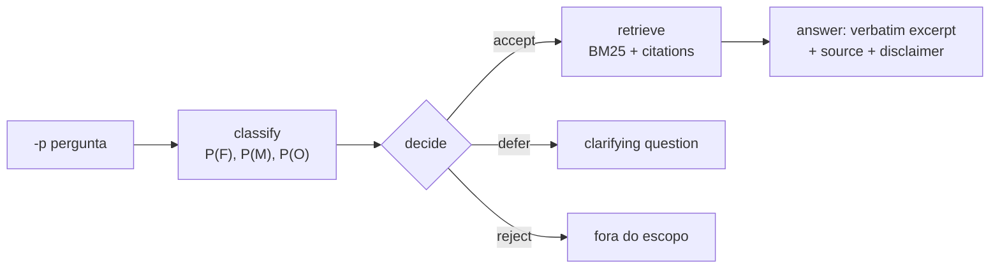

# CLI usage — how to use agavus

Status: **implemented** — `-p`, `classify`, `search`, `train`, `eval`,
`ingest`, `label` are live, with `--explain` (decision trace: probabilities,
expected losses, top features) and `--json` (typed output) accepted before
or after subcommands.
The CLI is the product surface for both goals: asking questions and
classifying documents. User-facing I/O is **pt-BR**; code and docs stay
English.

## Command surface

```sh
agavus -p "Qual é o artigo da lei de alienação parental?"   # ask (primary UX)
agavus classify "texto…"                                  # classify inline text
agavus classify --file peticao.txt                        # classify a document
agavus ingest --area F                                    # pipeline ops (later)
agavus index                                              # rebuild retrieval index
```

Flags (ask and classify):

| Flag | Effect |
| ------------ | ------------------------------------------------ |
| `--json` | machine-readable typed output (schema below) |
| `--explain` | decision trace: probabilities, expected losses, top features, retrieval scores |
| `--area X` | optional hint; never overrides the safety gate |

## What happens on `-p` (the full flow)



The answer is **always a cited excerpt**, never generated prose.

## Worked example (the founding query)

```
$ agavus -p "Qual é o artigo da lei de alienação parental?"

Decisão: accept · área F · confiança 0.93

Trecho relevante:
  "Considera-se ato de alienação parental a interferência na formação
   psicológica da criança ou do adolescente promovida ou induzida por
   um dos genitores, pelos avós ou pelos que tenham a criança ou
   adolescente sob sua autoridade, guarda ou vigilância…"

Fonte: Lei 12.318/2010, art. 2º, caput — Planalto (texto compilado)

Isto não é aconselhamento jurídico; consulte um advogado.
```

Behind the scenes: "alienação parental" votes F; citation/statute match
retrieves Lei 12.318/2010 art. 2º; α_F cleared → accept.

## The other two outcomes

Defer (boundary region — the engine asks, it does not guess):

```
$ agavus -p "meu ex não deixa eu ver meu filho"

Decisão: defer
Preciso de um esclarecimento: guarda/visitas ou pensão alimentícia?
```

Reject (out of scope, said plainly):

```
$ agavus -p "como funciona o habeas corpus?"

Decisão: reject
Fora do escopo: agavus cobre direito de família e violência doméstica
(Maria da Penha) no TJDFT.
```

## `--explain`: auditability as a feature

```
$ agavus -p "…" --explain

P(F)=0.93  P(M)=0.04  P(O)=0.03
Perda esperada: accept-F 0.62 · accept-M 5.7 · reject 3.9 · defer 1.0 → accept-F
Top features: alienacao_parental (+2.1), lei_12318 (+1.8), artigo (+0.4)
Retrieval: Lei 12.318/2010 art. 2º (BM25 11.3), art. 4º (8.1)
```

Every routing decision can be explained to a human — weights, losses,
scores. This is the auditability payoff of the linear core.

## `--json` output contract (typed)

```json
{
  "decision": "accept | defer | reject",
  "area": "F | M | null",
  "confidence": 0.93,
  "excerpt": "…verbatim text…",
  "sources": [{"ref": "Lei 12.318/2010, art. 2º", "origin": "planalto"}],
  "clarification": "…question when decision=defer…",
  "trace": { "probabilities": {}, "expected_losses": {}, "top_features": [] }
}
```

`trace` only with `--explain`. Fields are stable; consumers may rely on them.

## Exit codes (scriptable)

| Code | Meaning |
| ---- | ------------------------------ |
| 0 | answered (accept) |
| 10 | deferred — clarification needed |
| 20 | rejected — out of scope |
| 1 | internal error |

## Rules

1. **No legal advice, ever**: fixed disclaimer on every answered output.
2. **No excerpt without a source**: `sources` is never empty on accept.
3. **Safety gate is not bypassable**: `--area` hints never force acceptance;
   the M ceiling governs all routing.
4. **Determinism**: same question + same corpus/index version → same output.
5. Corpus/index version is reported by `agavus --version` (reproducibility).

Delivery guarantees (pre-delivery checklist, degradation ladder, feedback
loop): **[response-quality.md](response-quality.md)**.