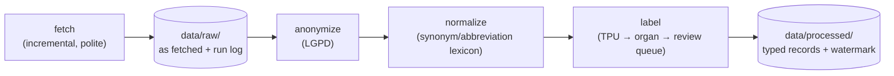

# Ingestion — raw data → processed records

Future module: `corpus/ingestion`. The pipeline is a one-way flow; raw data
is never mutated.

## Stages

1. **Fetch**: query each source for the window (2020-01-01 → today),
   incremental since the last watermark. Store responses verbatim in
   `data/raw/` with fetch timestamp + query parameters.
2. **Anonymize**: strip party names, CPF/RG, addresses, minors' identifiers
   before anything else touches the text ([privacy.md](privacy.md)).
3. **Normalize**: apply the taxonomy lexicon (abbreviations → canonical
   terms), unify citation formats, extract `citations` by regex.
4. **Label**: TPU mapping first, organ weak labels second, conflicts to the
   review queue ([labeling.md](labeling.md)).
5. **Store**: frozen typed records in `data/processed/`, keyed by
   deterministic `id`; update the watermark only after a successful run.

## Guarantees

- **Idempotent**: re-running the same day produces zero new records
  (deterministic ids + dedup).
- **Resumable**: a crash costs a resume from the watermark, not a restart.
- **Auditable**: every processed record points to its raw payload
  (`raw_ref`); every run writes a run-log entry (SQLite `meta_runs`: date,
  window, counts) and advances the watermark only on success.
- **Versioned, never edited**: reprocessing creates a new processed version;
  raw stays untouched forever.

## Dedup and splits

- Dedup key: `id` (process number for cases; source + origin_ref hash for
  texts). The same acórdão published in two places is one record.
- **Split discipline**: the same case never appears in both train and
  held-out sets. Split by case, preferably by time (train ≤ 2025,
  held-out 2026+) so evaluation mimics future cases.

## Failure handling

- Source errors: back off, retry, record the gap in the manifest; a partial
  run never advances the watermark past unfetched data.
- Label conflicts: never block ingestion — records land with
  `label_source: weak` and enter the review queue.