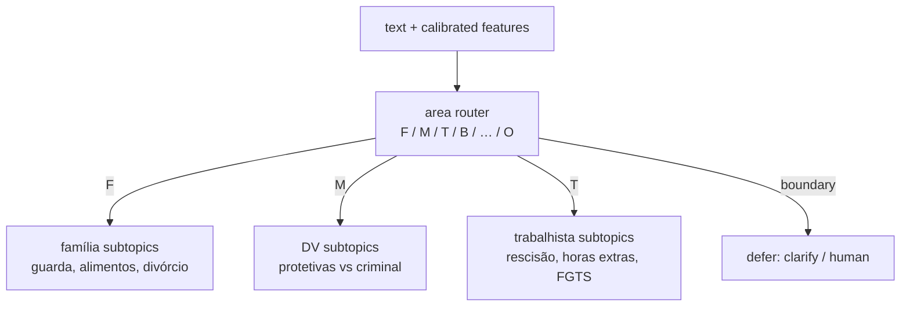

# Extensibility — adding new legal areas

How agavus grows beyond família/Maria da Penha to **trabalhista, bancário,
consumidor, previdenciário…** without rewrites.

**Core principle: an area is a data pack; the engine is invariant.**
Adding an area must mean *adding configuration and corpus*, never changing
pipeline code.

## What stays vs what varies

| Invariant (engine) | Per-area (pack) |
| ---------------------------------------- | -------------------------------------------- |
| TF-IDF, logreg, calibration, BM25, expected-loss math | label code + TPU mapping table |
| fetch → anonymize → normalize → label → store pipeline | tribunal filters + source adapters |
| record schema + provenance rules | synonym/abbreviation lexicon |
| three-way decision rule | loss-matrix row (costs) |
| privacy/LGPD rules, storage policy | organ weak-label rules |
| evaluation harness | statute set + gold set |

Geography stays an invariant for now: **DF-first** (TJDFT for F/M; trabalhista
would be TRT10/TST; bancário stays TJDFT + STJ). One region, many areas —
vocabulary and procedure stay coherent.

## The AreaSpec (area pack schema, draft)

A frozen, typed, versioned specification — future module `taxonomy/areas`:

```
AreaSpec:
  code: "T"                          # F, M, T, B, …
  name: "Direito trabalhista"
  status: planned | collecting | shadow | active
  tribunals: ["TRT10", "TST"]        # per-area, not global
  tpu_map_ref: "tpu/trabalhista@v1"  # versioned mapping table
  organ_rules_ref: "organs/trt10@v1"
  lexicon_ref: "lexicon/trabalhista@v1"
  statutes: ["CLT", "CF art. 7º", "Súmulas TST…"]
  loss_row: { … }                    # costs vs every other state
  gold_set_ref: "gold/trabalhista@v1"
```

Packs live in git (small, public taxonomy/config — never case data). Corpus
lands namespaced: `data/processed/areas/<code>/…`, with **per-area manifests
and watermarks** — ingesting trabalhista never touches F/M data.

## The registry seam (build now, extend later)

The one extension mechanism we implement from day one, even with two areas:

- All labels flow through a **registry** (`code → AreaSpec`); no module
  hardcodes `F`/`M` literals outside pack definitions.
- The loss matrix is **data composed from pack rows**, not a hardcoded table.
- Ingestion, training, and indexing take an area code as parameter.

Everything else in this doc is process, not machinery — deliberately. No
generic "legal ontology", no plugin framework, no premature abstraction.

## Routing: hierarchical, isolated



- **Stage 1**: area router (one multiclass model over active areas).
- **Stage 2**: per-area subtopic models — adding an area does **not** retrain
  existing subtopic models.
- The decide layer is unchanged: the loss matrix grows rows/columns; the
  expected-loss rule and α/β derivation are already general.

## Loss matrix composition + safety invariant

- Each pack declares its loss row: costs of accepting/rejecting/deferring
  against every other state. Cross-area costs default to a standard penalty
  and are overridden where errors are worse.
- **Safety invariant (non-negotiable)**: no new area may make M easier to
  reject or route away. M→F = 10 and Reject|M = 8 remain the global ceiling;
  every new pack passes a safety review against them.
- Matrix is versioned; every change re-runs the α/β sweep (design doc §8).

## Activation lifecycle — an area earns its way in

| Stage | Meaning | Gate to advance |
| ------------ | --------------------------------------- | -------------------------------------------- |
| `planned` | pack drafted, no data | sources verified, loss row reviewed |
| `collecting` | ingestion running, labels accumulating | gold set ≥ agreed size, label audit clean |
| `shadow` | classifies silently, answers nothing | F1/ECE targets met, boundary stats reviewed |
| `active` | routes and answers with citations | precision-on-accepted ≥ target (e.g. 0.95) |

Shadow mode is the key safety device: a new area proves itself on real
traffic **before** it is allowed to answer.

## Worked example: adding trabalhista

1. Draft pack `T`: tribunals TRT10/TST, CLT + CF art. 7º + súmulas TST,
   TPU map (rescisão, horas extras, FGTS, assédio), lexicon (CTPS, verbas
   rescisórias, TRCT), organ rules, loss row (prazo-sensitive costs).
2. Safety review: confirm M thresholds untouched.
3. Ingest into `areas/T/` (source adapter for PJe-JT if needed — behind the
   same fetch interface).
4. Retrain **only** the area router; trabalhista subtopic model is new.
5. Shadow → evaluate → activate. **Zero engine code changes.**

Bancário is the same recipe: TJDF + STJ, CDC + Lei 4.595/64 + súmulas STJ,
lexicon (SAC/PRICE, juros abusivos, revisional).

## Known overlap risks (handled, not solved)

- **Trabalhista ↔ bancário**: bank-employee labor disputes.
- **Bancário ↔ família**: debt division in divórcio.
- **M ↔ everything**: DV context can appear in any area.

Policy unchanged: boundary region defers; M signals always win priority
(safety invariant); multi-label remains the documented evolution path.

## What we deliberately do NOT build yet

- Plugin systems, generic ontologies, area auto-discovery.
- Per-area embedding models or LLMs (tiers 4–5 stay global and optional).
- Cross-tribunal generalization (separate later phase, design doc §3).

The only machinery built now: **registry, namespaced storage, matrix-as-data,
area-parameterized pipelines**. The rest is this documented process.