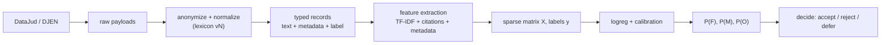

# Classification pipeline — how the engine reads data

The engine never "reads" text — it **counts symbols through a frozen
pipeline**. This doc traces the exact path from public data to a classified
prediction. Future modules: `corpus` → `classify` → `decide`.

## The full path

## What the classifier consumes

Each record becomes **one row of numbers** — a sparse vector assembled from
three feature groups:

### 1. Text features (from `TextDocument.text`)

- Normalize first: the lexicon maps abbreviations/synonyms to canonical
  terms ("LMP" → "lei maria da penha").
- Tokenize → word unigrams + bigrams ("medida protetiva" as one unit) +
  char n-grams (`prot`, `rotet` — catches protetiva/protetivas).
- Negation scoping: "indefiro a protetiva" produces `nega_protetiva`, a
  *different* feature (design doc §6.1 #1).
- [TF-IDF](tfidf.md) weights each feature; the vocabulary is **fitted once
  on the training split and frozen**.

### 2. Citation features (binary flags)

- Regex extracts "art. 22, III, Lei 11.340/2006" → `cite:lei_11340_art_22 = 1`.
- In legal text these are near-decisive: citing Lei 11.340 is a massive M
  signal.

### 3. Metadata features (from `CaseRecord` — crucial for F/M)

- One-hot TPU classe/assunto codes; organ patterns ("vara violência
  doméstica" → flag).
- This is how sealed cases (no full text) still get classified:
  metadata *is* the input (see [../corpus/sources.md](../corpus/sources.md)).

One row ≈ `[tfidf terms…, citation flags…, metadata flags…]` — mostly zeros,
a few hundred active entries. Labels `y` come from `label_source`
(tpu / organ / manual).

## Concrete walkthroughs

**Query**: *"meu ex não deixa eu ver meu filho"*

1. Normalize → tokens `ex`, `não`, `deixa`, `ver`, `filho` (+ bigrams,
   char n-grams).
2. Vectorize with the **frozen** vocabulary → known terms get weights;
   unknown words are ignored (no crash, no understanding).
3. No citations, no metadata → those groups are all zero.
4. Model: "filho", "ver" vote F; weak evidence overall → e.g.
   `P(F) = 0.62, P(M) = 0.05, P(O) = 0.33`.
5. Decide: 0.62 < α_F (0.89) → **defer** → clarifying question:
   *"Guarda/visitas ou pensão?"*

**Document**: *"DEFIRO a medida protetiva… art. 22, Lei 11.340/2006"*

Citation flag + "protetiva" + "defiro" → `P(M) = 0.97` → **accept as M**.

## The three rules that make it work

1. **Train/serve symmetry**: inference runs the *identical* pipeline —
   same lexicon version, same frozen vectorizer, same feature extractors.
   Drift here silently corrupts probabilities. Artifacts are versioned
   together.
2. **Separate learning, confidence and grading**: training fits vocabulary,
   IDF and model weights; a separate calibration partition fits temperature;
   final holdout measures quality. Keep each case and duplicate text group
   together; prefer newer cases for calibration and evaluation. Undated
   statutes and seeds remain auxiliary training data when dated cases are
   available (see [../evals.md](../evals.md#splits-and-leakage)).
3. **Determinism**: same input → same vector → same probabilities. No
   randomness at inference — this is what makes the safety thresholds
   trustworthy.

## Summary

"Reading" = normalize → count → weight → vote → calibrate → price the
decision. The engine's entire "understanding" of Portuguese is the frozen
vocabulary plus weights learned from TJDFT statistics.

Related: [tfidf.md](tfidf.md), [logistic-regression.md](logistic-regression.md),
[calibration.md](calibration.md), [three-way-decisions.md](three-way-decisions.md).
