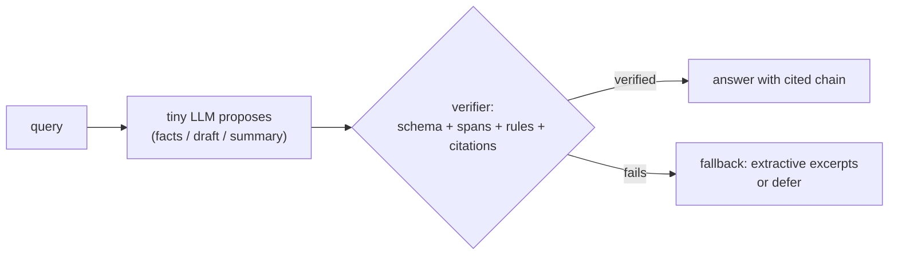

# Tiny LLM — making agavus smarter on CPU

Status: design, **later phase, activation-gated**. A small quantized language
model as an optional layer — never the source of truth. The classical core
stays; the tiny LLM is a peripheral that *proposes* while the engine
*verifies*. Companion: [reasoning.md](reasoning.md).

## Why tiny, and what "tiny" means

0.5B–4B parameters, quantized (GGUF, Q4_K_M), running via **llama.cpp**
(`llama-cpp-python`, pure pip, CPU build — no Node, no GPU).

| Model class | RAM (Q4) | CPU speed (modern 8-core, approx.) |
| ---------------------- | -------- | ---------------------------------- |
| 0.5–0.6B (Qwen3-0.6B) | ~0.5 GB | ~25–50 tok/s |
| 1.5–1.7B (Qwen3-1.7B) | ~1.2 GB | ~12–25 tok/s |
| 3–4B (Qwen3-4B) | ~2.5 GB | ~6–12 tok/s |

Speeds are hardware-dependent ranges, not promises. A 200-token grounded
answer: seconds at 0.6B, up to a minute at 4B. Sweet spot for pt-BR:
**Qwen family 1.7B–4B** (strong multilingual); Llama-3.2-1B/3B weaker in
Portuguese; pt-BR-specialized models (Sabiá) are API-only — an allowed
alternative under the same verifier contract, but external.

Fine-tuning on CPU is impractical. Value comes from **RAG + few-shot
exemplars + constrained decoding**, not from training. Optional later:
distill from an API teacher and LoRA once on rented GPU — explicitly out
of MVP.

## The iron rule: transformer, not oracle

A tiny model's legal knowledge in its weights is **unreliable** — it will
hallucinate article numbers with total confidence. Therefore:

> The LLM never recalls law. It only **transforms text we provide**.
> Every output is verified against sources, or discarded.

## Where it makes agavus smarter (each with a verifier)

| Role | LLM does | Verifier |
| ---------------------- | ---------------------------------------- | ------------------------------------------ |
| Query understanding | decompose, normalize, extract facts as JSON | schema (GBNF grammar) + facts must be extractive spans of the query |
| Clarification | draft the defer question | template bounds; question must reference extracted ambiguity |
| Grounded summarization | condense retrieved excerpts | every sentence maps to a source span (overlap/entailment check); fail → raw excerpts |
| Syllogism drafting | propose minor-premise mappings | symbolic rules check conditions against cited premises |
| Answer polish | fluency over the cited chain | citations preserved verbatim; claims checked against excerpts |

Constrained decoding (llama.cpp **GBNF grammars**) forces valid JSON/
structure — the model cannot wander outside the schema.

## The verification loop

Fallback is always the classical engine — the LLM layer can only add
value, never remove safety. The three-way gate and the M ceiling govern
everything, unchanged.

## Determinism and caching

The classical core is deterministic; LLM sampling is not. Contract:

- temperature 0, fixed seed, pinned model file + prompt template versions.
- Outputs **cached** keyed by `hash(input + model version + corpus version
  + prompt version)` — repeated queries are instant and stable.
- `--version` reports model + prompt versions alongside corpus version.
- Residual nondeterminism (hardware/threads) is documented; the verified
  classical path remains the reproducibility backbone.

## Storage and deps

- Weights are large artifacts: **never in git**, live under
  `AGAVUS_MODELS_DIR` (default `data/models/`), same rebuildable-cache
  principle as the corpus (re-downloadable, checksum-pinned).
- New runtime dep when implemented: `llama-cpp-python` (CPU build needs a
  C compiler/cmake — documented in setup).

## Activation gate (like areas: shadow first)

| Check | Target |
| ---------------------------------------- | ------------------------------ |
| Citation precision on gold set | ≥ classical baseline |
| Hallucination rate (wrong article/number) | 0 on gold set |
| Verifier fallback rate | tracked, bounded |
| Latency budget (p95) | agreed per command |
| Ablation: with vs without LLM layer | must improve, not regress |

The layer ships **disabled by default**, enabled per deployment after
shadow-mode evidence. If it ever regresses precision, it is turned off —
the engine is complete without it.

## Worked example (verifier catches a hallucination)

Query: *"Qual é o artigo da lei de alienação parental?"*

1. LLM extracts facts `{tema: alienação parental, pedido: artigo}` —
   spans verified against the query. ✅
2. Retrieval returns Lei 12.318/2010, art. 2º (BM25 top hit).
3. LLM drafts: "o art. 5º define alienação parental…" — verifier checks
   the claim against the excerpt: **art. 5º ≠ art. 2º → rejected**. ❌
4. Fallback: verbatim art. 2º excerpt + citation. The user gets the
   correct answer; the hallucination never surfaces.

That is the whole philosophy: **the tiny LLM makes agavus feel smarter;
the verifier keeps it honest.**