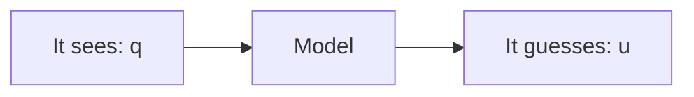
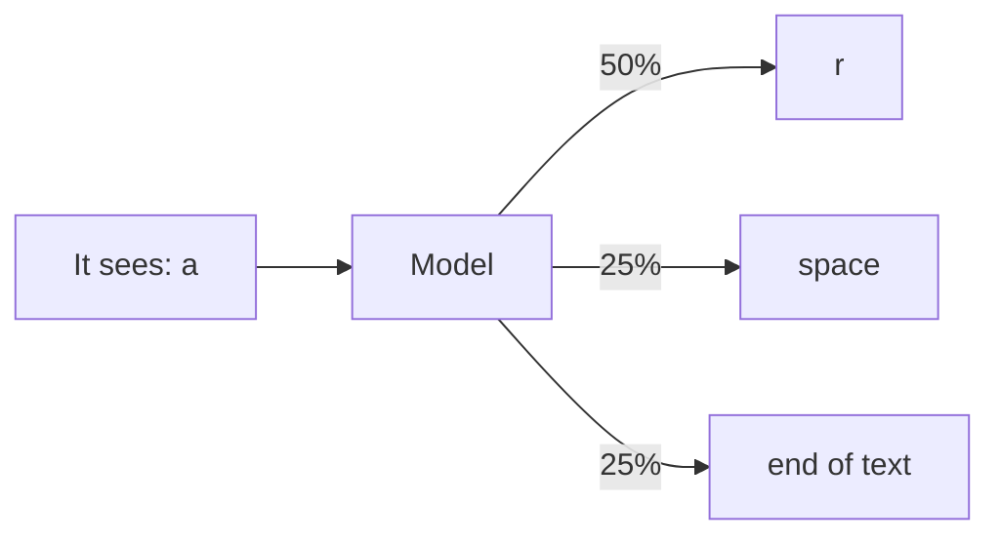

# 1. Guess the next letter

Your phone keyboard suggests the next word. A **language model** does the
same thing: it looks at some text and guesses what comes next.

Ours is the smallest possible one. It sees **one letter** and guesses the
**next letter**.

It doesn't give one answer. It gives a **chance** to every letter:

Those chances always add up to 100%.

Because it looks at a pair (this letter, the next one), it's called a
**bigram**: "bi" means two.

## What about ChatGPT or Claude?

They do the same job with two big differences:

| | Our bigram | A large model |
| --- | --- | --- |
| Looks back at | 1 letter | thousands of words |
| Learned from | a few laws | a huge amount of text |

## Check yourself

Our model sees the `d` in `guarda` and must guess the next letter.
Does it know that the letters before were `guar`?

Answer

No. It sees only `d`. Everything earlier is forgotten.

Next: [2. Letters become numbers](02-letters-become-numbers.md)
