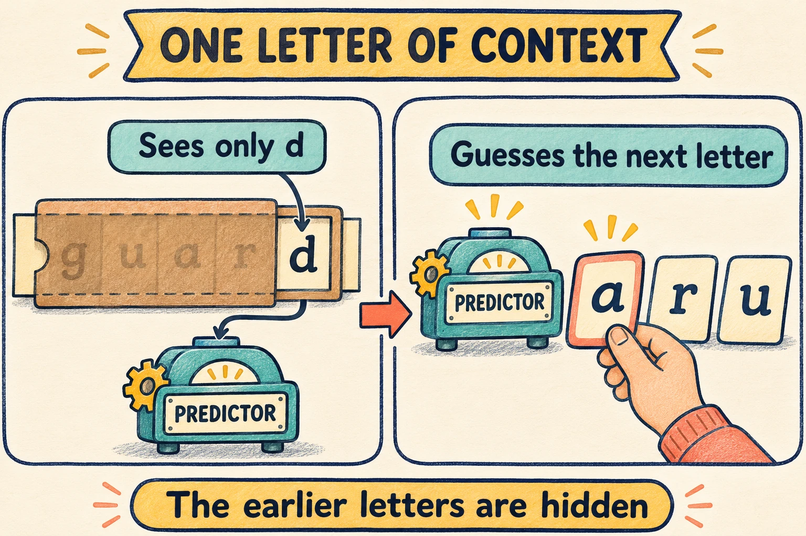
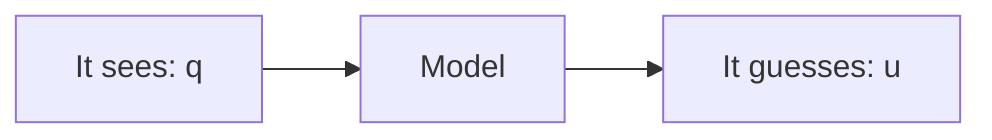
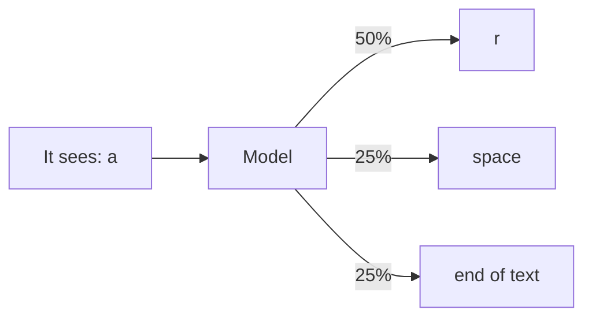

# 1. Guess the next letter



Cover the earlier tiles: the bigram gets only `d`. It scores possible next
letters without seeing the `guar` before it.

## Think of finishing someone's sentence

Someone says "bom..." and you anticipate "dia". A language model also uses
earlier text to score possible continuations. Our first model gets a much
smaller clue: only the previous letter. Try predicting after `d` in `guarda`.

**Where the analogy stops:** anticipating text doesn't show that the model
knows the speaker's intentions or checks whether a statement is true.

Your phone keyboard suggests the next word. A **language model** does the
same thing: it looks at some text and guesses what comes next.

Ours is the smallest possible one. It sees **one letter** and guesses the
**next letter**.



It doesn't give one answer. It gives a **chance** to every letter:



Those chances always add up to 100%.

Because it looks at a pair (this letter, the next one), it's called a
**bigram**: "bi" means two.

## What about ChatGPT or Claude?

They do the same job with two big differences:

| | Our bigram | A large model |
| --- | --- | --- |
| Looks back at | 1 letter | thousands of words |
| Learned from | a few laws | a huge amount of text |

## Python: try it

This handwritten table uses the raw pairs in `guarda guarda`. It isolates
prediction; lesson 3 adds training and smoothing.

```python
# Store a probability row for each possible current letter in this small demo.
table = {"a": {"r": 0.5, " ": 0.25, "<end>": 0.25}, "d": {"a": 1.0}}
current = "a"  # Give the predictor one letter, without the earlier sentence.
chances = table[current]  # Read only the probability row for that letter.
# max compares tokens by their probability; the lambda supplies that number.
guess = max(chances, key=lambda token: chances[token])
for token, chance in chances.items():  # Visit each possible continuation.
  print(repr(token), f"{chance:.0%}")  # repr makes the space token visible.
print("Most likely:", guess)  # The largest probability belongs to r.
assert sum(chances.values()) == 1.0  # All alternatives together must total 100%.
```

You should see 50%, 25%, and 25%, with `r` most likely. Change `current`
to `"d"` and see how the selected row changes.

## Check yourself

Our model sees the `d` in `guarda` and must guess the next letter.
Does it know that the letters before were `guar`?

<details><summary>Answer</summary>

No. It sees only `d`. Everything earlier is forgotten.

</details>

Next: [2. Letters become numbers](02-letters-become-numbers.md)
