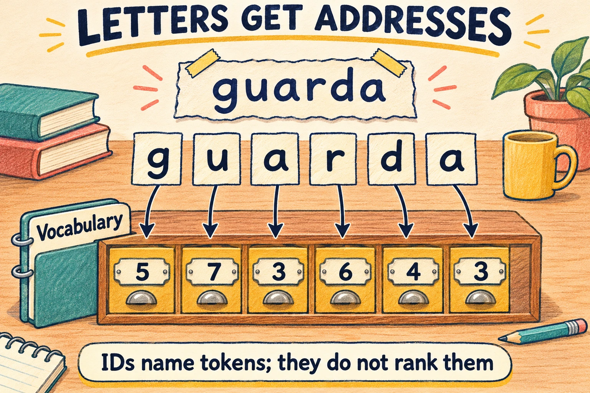
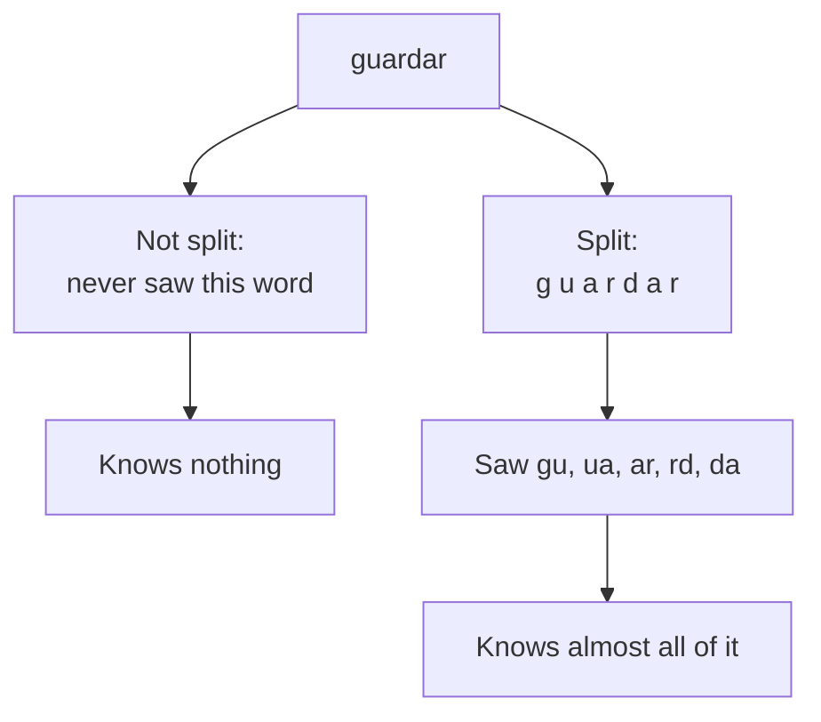
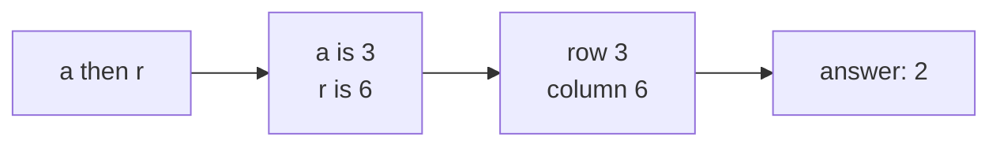

# 2. Why split the text, and why use numbers?



Follow each letter to its ID: `guarda` becomes `5, 7, 3, 6, 4, 3` in our
vocabulary. Both `a` tiles use address 3; the IDs don't rank their meanings.

## Think of sounding out an unfamiliar word

You can meet a new word and still recognize its letters. Splitting text lets
the model reuse familiar pieces too. We then give each piece a numbered
address, like an entry in an address book: `a` is entry 3 in our example.

**Where the analogy stops:** recognizing a token doesn't give the model its
meaning. An ID is just an address; learned vectors come later, in lesson 10.

Two different questions. One at a time.

## Why split?

Because **whole texts almost never repeat, but small pieces repeat all the
time.** Repeated pieces give us more evidence about what tends to follow them.

Imagine the model studied only `guarda`, and now meets `guardar`:



It's like Lego. With a few kinds of bricks you can build anything, even
things you've never built before.

Letters aren't the only choice of brick:

| Brick | Example | Good | Bad |
| --- | --- | --- | --- |
| Letters | g·u·a·r·d·a | few bricks, any word works | each says very little |
| Word pieces | guard·a | a balance | needs an extra step |
| Whole words | guarda | each says a lot | too many; new words fail |

We start with letters because they're the simplest. Real LLMs use word pieces.

## Why numbers?

Our model is **a table of counts**. To use a table, you need to know which row
and which column. The number is the **address**.

After studying `guarda guarda`, part of the table looks like this:

| | column 2: space | column 3: a | column 6: r |
| --- | --- | --- | --- |
| **row 3: a** | 1 | 0 | 2 |
| **row 4: d** | 0 | 2 | 0 |

"How often did `r` come after `a`?" becomes "row 3, column 6", and the answer
is 2.



Like seats in a theater: your ticket says row 3, seat 6. The number doesn't
describe the seat; it only says **where to find it**. So `u` = 7 isn't "more"
than `a` = 3. We could number the letters in any order, if we always use the
same one.

## Each piece is called a token

The list of all tokens is the **vocabulary**. Ours, for `guarda guarda`:

| Number | 0 | 1 | 2 | 3 | 4 | 5 | 6 | 7 |
| --- | --- | --- | --- | --- | --- | --- | --- | --- |
| Token | ■ | ? | space | a | d | g | r | u |

Two are special: **■** marks the start or end of a text, and **?** stands for
a letter we never saw.

## Python: try it

Build the vocabulary addresses yourself, then turn the IDs back into text.

```python
text = "guarda guarda"  # Use the same tiny training text as the illustration.
letters = sorted(set(text))  # Keep each character once, in a repeatable order.
# Reserve IDs 0 and 1, then append the characters; * unpacks the letter list.
tokens = ["<boundary>", "<unknown>", *letters]
# enumerate supplies each position; the dictionary maps token text to that ID.
token_to_id = {token: number for number, token in enumerate(tokens)}
ids = [token_to_id[letter] for letter in text]  # Look up each character's address.
restored = "".join(tokens[number] for number in ids)  # Join the addressed letters.
print(token_to_id)  # Check that a is 3, d is 4, g is 5, r is 6, and u is 7.
print(ids)  # Repeated characters reuse the same ID.
assert restored == text  # Encoding and decoding must preserve the original text.
```

The two special IDs are reserved here; the text isn't wrapped in boundaries
yet. The lab's `vocab.encode` adds those boundaries automatically.

## Check yourself

1. Why is it easier to learn from pieces than from whole sentences?
2. Which row and column hold "how often `u` came after `g`"?

<details><summary>Answers</summary>

1. The same sentence rarely appears twice, but its pieces appear many times.
2. Row 5 (`g`), column 7 (`u`).

</details>

Next: [3. Learn by counting](03-learn-by-counting.md)
