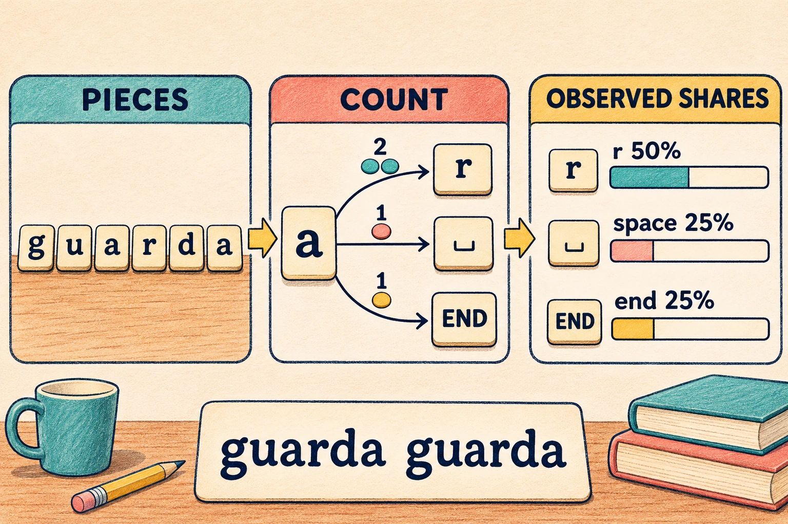
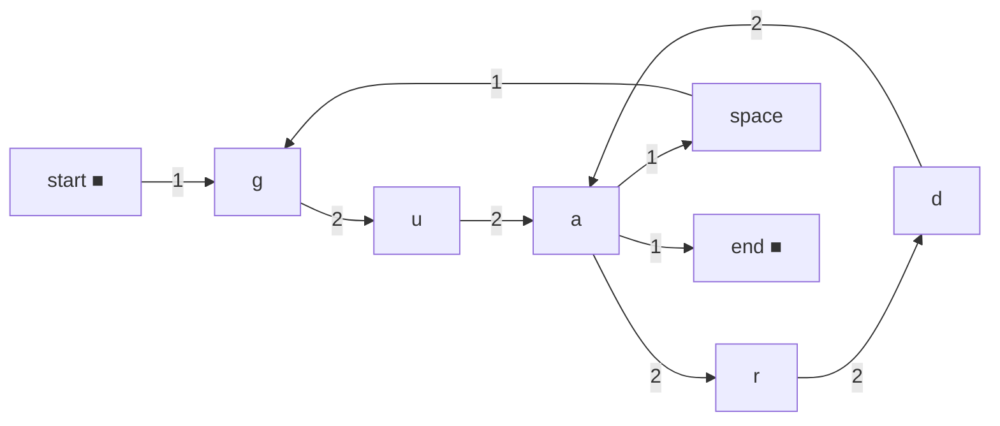

# 3. Learn by counting



Follow the three arrows from `a`: two `r`s, one space, one end. These are
observed shares **before smoothing**; adding 1 changes the probabilities below.

## Think of expectations built from repetition

After seeing the same sequence repeatedly, you start expecting its next part.
Our bigram makes that idea explicit with tally marks. In `guarda guarda`, `a`
is followed by `r` twice out of four occasions: an observed share of 50%.

**Where the analogy stops:** this model only counts adjacent tokens. It
doesn't discover a grammar or know why a pair occurs. Smoothing adds a small
allowance for unseen pairs; it doesn't supply that missing knowledge.

How does the model know what follows `a`? **It looks and counts.**

Find every `a` in the text, and see what comes after it:

```
■ g u a r d a ␣ g u a r d a ■        (␣ is a space)
      ↑     ↑       ↑     ↑
      r     ␣       r     ■
```

There are 4 `a`s. After them: `r` twice, a space once, the end once.

| After `a` comes | Count | Chance |
| --- | --- | --- |
| r | 2 | 2 ÷ 4 = **50%** |
| space | 1 | 1 ÷ 4 = **25%** |
| ■ (end) | 1 | 1 ÷ 4 = **25%** |

That's all the training there is: **count, then divide**.

Here is everything it learned. The number on an arrow is how many times it
happened:



Only `a` has more than one arrow out. It's the only letter where the model
isn't sure.

## One problem, one fix

`g` was always followed by `u`, so `gr` gets 0%: "impossible". But `gr` is
normal in Portuguese (`agressor`). The model has just never seen it.

The fix is called **smoothing**: before dividing, pretend we saw every pair
one extra time.

| | Before | After smoothing |
| --- | --- | --- |
| a → r | 2 ÷ 4 = 50% | (2 + 1) ÷ (4 + 8) = **25%** |
| g → r | 0 ÷ 2 = 0% | (0 + 1) ÷ (2 + 8) = **10%** |

Why `+ 8` below? There are 8 tokens, and each got one extra.

Our text is tiny, so one extra changes a lot. With thousands of letters, it
changes very little.

## Check yourself

After smoothing, what's the chance of `g → u`?

<details><summary>Answer</summary>

(2 + 1) ÷ (2 + 8) = 3 ÷ 10 = **30%**.

</details>

Next: [4. Score the guesses](04-score-the-guesses.md)
