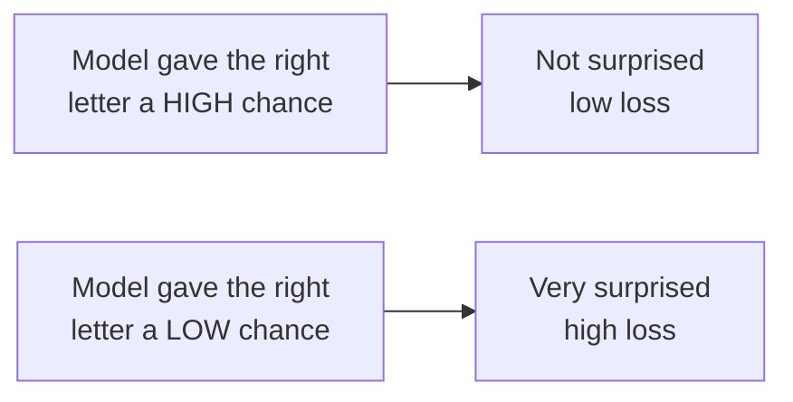

# 4. Score the guesses

Is the model any good? We need one number. It's called **loss**, and it means
**surprise**.

**Lower is better.** Zero would mean it's always certain and right.

| Chance given to the right letter | Loss |
| --- | --- |
| 100% | 0.00 |
| 90% | 0.11 |
| 50% | 0.69 |
| 25% | 1.39 |
| 10% | 2.30 |
| 1% | 4.61 |
| 0% | infinite |

You don't need to calculate it by hand. (The formula is `-ln(chance)`; your
calculator's `ln` key does it.) The last row is why lesson 3 needed smoothing:
a single "impossible" letter would break the score.

## Scoring a whole word

Score every step, then take the average. For `guarda`, with smoothing:

| Step | Chance | Loss |
| --- | --- | --- |
| ■ → g | 22% | 1.50 |
| g → u | 30% | 1.20 |
| u → a | 30% | 1.20 |
| a → r | 25% | 1.39 |
| r → d | 30% | 1.20 |
| d → a | 30% | 1.20 |
| a → ■ | 17% | 1.79 |
| **Average** | | **1.36** |

## Is 1.36 good?

Compare it with someone who knows nothing and picks any of the 8 tokens
equally. Their loss is **2.08**. Ours is lower, so the model learned something.

On the real laws:

| | Loss |
| --- | --- |
| Knows nothing (98 tokens) | 4.585 |
| **Our bigram** | **2.296** |

Only compare losses when the tokens and the test text are the same.

## Check yourself

Model A gave the right letter 50%. Model B gave it 10%. Who has the lower
loss?

Answer

Model A: 0.69 against 2.30. It was less surprised.

Next: [5. Use an exam](05-use-an-exam.md)
