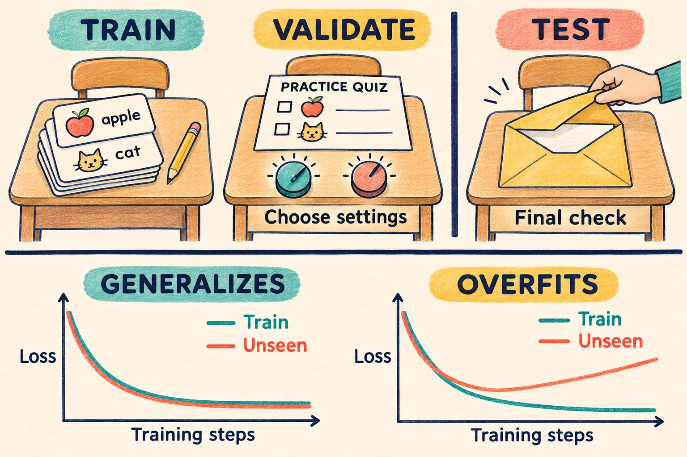
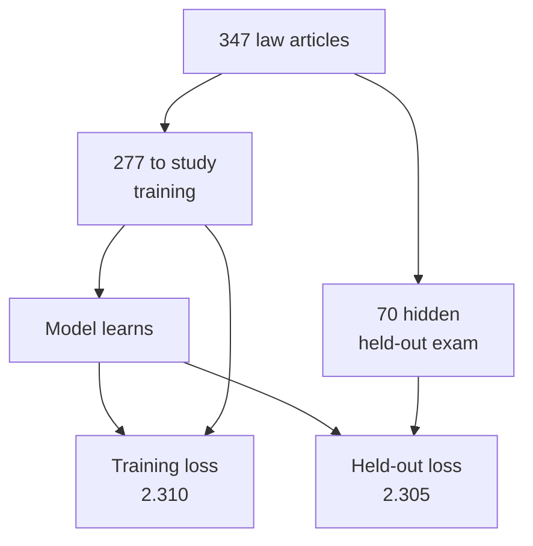

# 5. Use an exam



Use practice examples to train, validation to choose settings, and the final
test to assess the choice. The curves illustrate patterns; they aren't run logs.

## Think of practising a skill, then trying a new problem

Repeating a worked answer can hide what you haven't learned. A fresh question
tests whether the pattern transfers. Training text is our practice sheet;
held-out text is the new problem. Later we add validation: a practice exam
for choosing settings, separate from the final exam.

**Where the analogy stops:** scores depend on what the exam covers. Similar
training and exam scores don't prove that nothing was memorized, or that the
model will handle another court, topic, or writing style.

A student who sees the exam questions beforehand can get 100% and understand
nothing. Models can do that too.

So we hide part of the text. The model never trains on it.



**The held-out loss is the one that counts.**

Compare the two:

| What you see | What it means |
| --- | --- |
| Both high | too simple, or not trained enough |
| Training low, held-out much higher | **overfitting**, or a different text distribution |
| Both low and close | evidence of generalization on this held-out text |

Ours are nearly equal on this split: there is little measured gap. A bigram
can't condition on a whole article, but it can still overfit pair frequencies.
Its main limitation here is the one-letter context.

## An exam question

Let's test the tiny model on `guia`, a word it never saw:

| Step | Chance | Loss |
| --- | --- | --- |
| ■ → g | 22% | 1.50 |
| g → u | 30% | 1.20 |
| u → ? (it's `i`) | 10% | **2.30** |
| ? → a | 13% | **2.08** |
| a → ■ | 17% | 1.79 |
| **Average** | | **1.78** |

It's fine on `gu`, which it knows, and surprised by `i`. The average is worse
than the 1.36 for `guarda`.

## Python: try it

Use the real article-splitting helper with 15 synthetic strings. Split the
study portion again for validation, before building the vocabulary.

```python
from agavus.model.bigram import build_vocab, train_bigram  # Vocabulary and learner.
from agavus.model.data import split_articles  # Keep whole articles on one side.

articles = tuple(f"guarda exemplo {n}" for n in range(15))  # Invent 15 distinct texts.
outer = split_articles(articles)  # Reserve every fifth text as the final test.
inner = split_articles(outer.train)  # Reserve validation from the remaining texts.
training, validation, test = inner.train, inner.holdout, outer.holdout  # Name the roles.
vocab = build_vocab(training)  # Learn token identities from training text only.
model = train_bigram(training, vocab=vocab)  # Count only training pairs.
print(len(training), len(validation), len(test))  # Expect 9, 3, and 3 texts.
print("Validation loss:", model.loss(validation))  # Inspect the practice-exam score.
print("Final test loss:", model.loss(test))  # Score once after fixing this setup.
assert set(training).isdisjoint(validation)  # No training text may enter validation.
assert set(training).isdisjoint(test)  # No training text may enter the final test.
assert set(validation).isdisjoint(test)  # The two evaluation portions must differ.
```

These strings stand in for articles; the real corpus also needs separation
by case. Don't keep changing settings after looking at the final test score.

## Check yourself

A model has training loss 0.10 and held-out loss 5.00. What happened?

<details><summary>Answer</summary>

That large gap suggests overfitting if the texts come from the same
distribution. Also check that the split and preprocessing are comparable.

</details>

Next: [6. Write new text](06-write-new-text.md)
