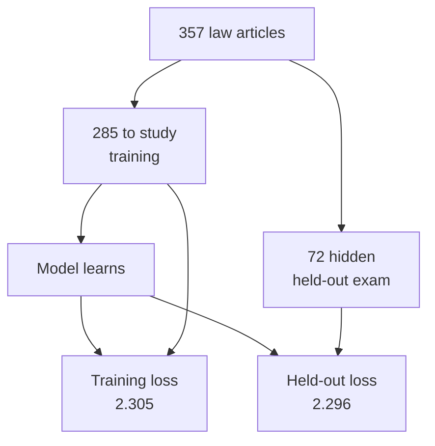

# 5. Use an exam

A student who sees the exam questions beforehand can get 100% and understand
nothing. Models can do that too.

So we hide part of the text. The model never trains on it.

**The held-out loss is the one that counts.**

Compare the two:

| What you see | What it means |
| --- | --- |
| Both high | too simple, or not trained enough |
| Training low, held-out much higher | **memorizing** ("overfitting") |
| Both low and close | learning something general |

Ours are nearly equal, so it isn't memorizing. It can't: it remembers only one
letter. It's simply a weak model.

## An exam question

Let's test the tiny model on `guia`, a word it never saw:

| Step | Chance | Loss |
| --- | --- | --- |
| ■ → g | 22% | 1.50 |
| g → u | 30% | 1.20 |
| u → ? (it's `i`) | 10% | **2.30** |
| ? → a | 13% | **2.08** |
| a → ■ | 17% | 1.79 |
| **Average** | | **1.78** |

It's fine on `gu`, which it knows, and surprised by `i`. The average is worse
than the 1.36 for `guarda`.

## Check yourself

A model has training loss 0.10 and held-out loss 5.00. What happened?

Answer

It memorized the training text and can't handle new text: overfitting.

Next: [6. Write new text](06-write-new-text.md)
