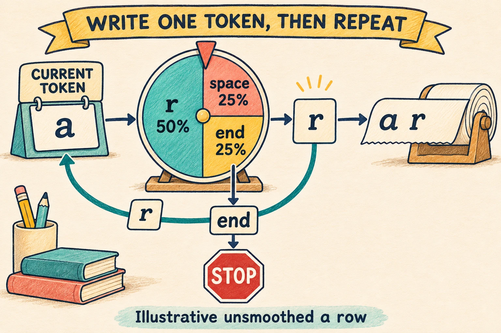
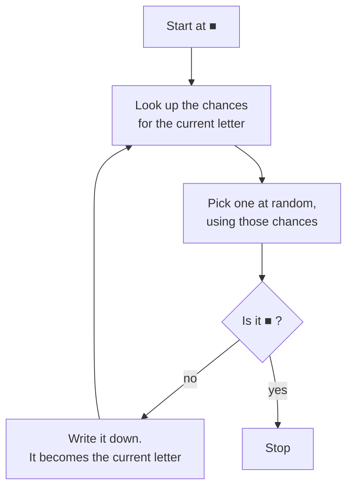
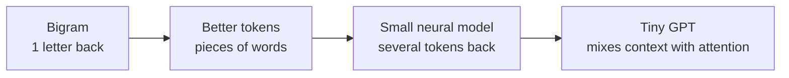

# 6. Write new text

The wheel illustrates the **unsmoothed `a` row** from our tiny text. If it
selects `r`, consult the `r` row next; don't keep spinning the `a` wheel.

## Think of improvising one phrase at a time

You say something, then its ending becomes the starting point for your next
phrase. Generation also feeds its own output back into the next prediction.
For our bigram, writing `a` means consulting the `a` row again; it can't tell
which `a` in `guarda` it has reached.

**Where the analogy stops:** this model isn't planning a message. Sampling
selects tokens using calculated probabilities, without checking their truth.
Its weights or counts stay fixed while it writes.

Guess a letter, then use it to guess the next one. Repeat. That's how a model
writes.

"At random, using those chances" is like a wheel with slices. `r` with 50% has
a slice twice as big as a space with 25%. Likely letters win often, not always.

## What ours writes

After reading the real laws:

> Ass cr prece denúntídana elulhe ... deiação qu ...

The pairs of letters look Portuguese, such as `qu` and `ção`. The words don't
exist, because **it remembers only one letter**.

## Two things to remember

1. **Sounding right isn't being right.** The model picks likely letters. It
   doesn't know what is true. This is why Agavus answers with quoted laws.
2. **More context can improve text.** The next models look further back,
   but still need enough data and training to use it:

## Check yourself

Why can't our bigram reliably write the word `guarda`?

Answer

At `a` it can't tell whether it's at the first `a` (then `r`) or the last one
(then the end). It sees only `a`, so it has to pick by chance.

Back to the [lesson list](README.md)
