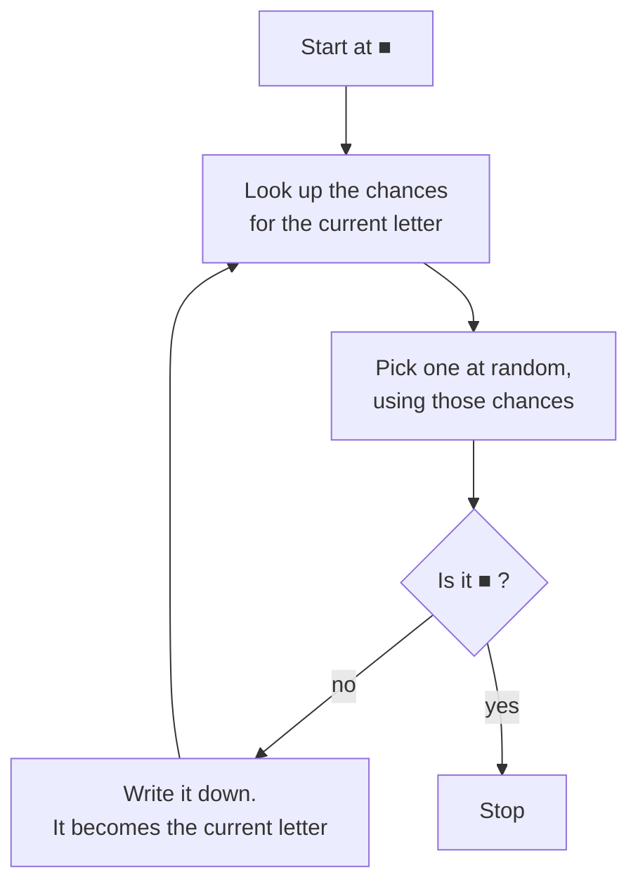
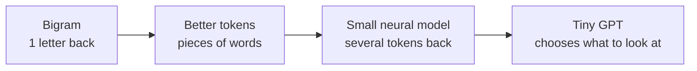

# 6. Write new text

Guess a letter, then use it to guess the next one. Repeat. That's how a model
writes.

"At random, using those chances" is like a wheel with slices. `r` with 50% has
a slice twice as big as a space with 25%. Likely letters win often, not always.

## What ours writes

After reading the real laws:

> Ass cr prece denúntídana elulhe ... deiação qu ...

The pairs of letters look Portuguese, such as `qu` and `ção`. The words don't
exist, because **it remembers only one letter**.

## Two things to remember

1. **Sounding right isn't being right.** The model picks likely letters. It
   doesn't know what is true. This is why Agavus answers with quoted laws.
2. **More memory makes better text.** The next models look further back:

## Check yourself

Why can't our bigram reliably write the word `guarda`?

Answer

At `a` it can't tell whether it's at the first `a` (then `r`) or the last one
(then the end). It sees only `a`, so it has to pick by chance.

Back to the [lesson list](README.md)
