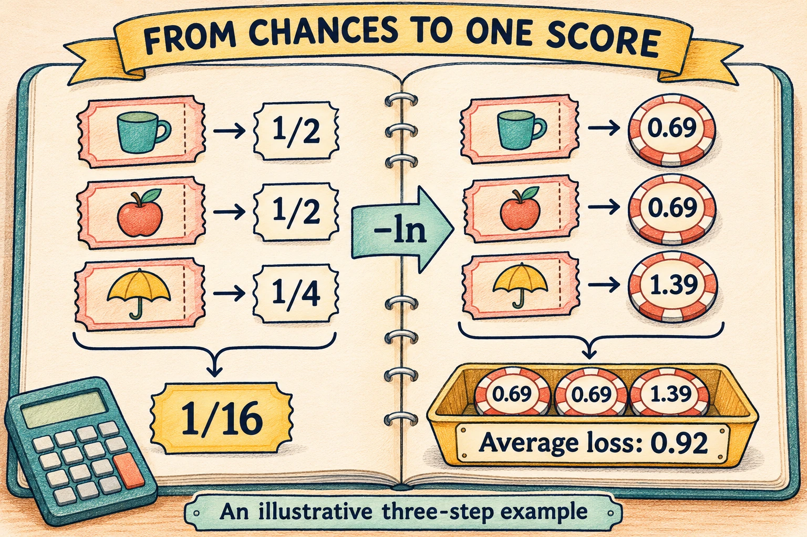
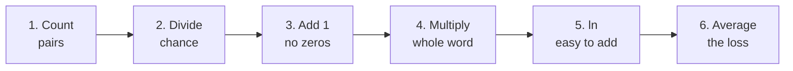

# 7. The math, step by step



A separate three-step example: `1/2 × 1/2 × 1/4 = 1/16`. Its total surprise
is about 2.77 and mean loss 0.92. Below, we calculate all seven `guarda` steps.

## Think of keeping a scorecard of your expectations

For every next letter, record how much chance you gave the answer that
actually appeared. Then combine the scores. A coin gives heads a chance of
1/2; two heads in a row have chance 1/4. Logarithms let us add those separate
surprises instead of multiplying ever-smaller probabilities.

**Where the analogy stops:** this is a score of predictions under our model,
not a measurement of human understanding. Each symbol below names a count,
a probability, or an operation you can check by hand.

Only four operations: **count, divide, multiply, and `ln`**.



## 1. Count

Text: `■ g u a r d a ␣ g u a r d a ■`. Slide a window of two tokens:

`■g  gu  ua  ar  rd  da  a␣  ␣g  gu  ua  ar  rd  da  a■`

That's 14 pairs. Those starting with `a`: `ar`, `a␣`, `ar`, `a■`. So
`count(a, r) = 2`, and `total(a) = 4`.

## 2. Divide

```
P(r | a) = count(a, r) / total(a) = 2 / 4 = 0.50
```

Read `P(r | a)` as "the chance of `r`, **given that** we're at `a`".

## 3. Add 1 (smoothing)

`V` is the number of tokens, 8. Add 1 to each of the 8 counts in the row, so
the total grows by 8:

```
P(next | current) = (count + 1) / (total + V)
P(r | a)          = (2 + 1) / (4 + 8) = 3 / 12 = 0.25
```

## 4. Multiply

The chance of a whole word is the chance of every step, multiplied. Like two
coins both landing heads: 0.5 × 0.5 = 0.25.

```
guarda = 0.222 × 0.3 × 0.3 × 0.25 × 0.3 × 0.3 × 0.167 = 0.000075
          ■→g    g→u   u→a   a→r    r→d   d→a   a→■
```

A long text would give a number so tiny that the computer rounds it to 0.

## 5. Use ln

`ln` turns multiplying into adding: `ln(a × b) = ln(a) + ln(b)`.

The `ln` of a number between 0 and 1 is negative, so we put a minus in front
to get a positive score:

```
-ln(0.25) = 1.39      low chance, more surprise
-ln(0.50) = 0.69
-ln(1.00) = 0         certain, no surprise
```

## 6. Average

Add the surprise of all 7 steps, then divide by 7 so that long texts aren't
punished for being long:

```
(1.50 + 1.20 + 1.20 + 1.39 + 1.20 + 1.20 + 1.79) / 7 = 9.50 / 7 = 1.36
```

(The terms are rounded; the total uses exact values.)

**1.36 is the loss.** Going backward, `e^1.36 ≈ 3.9`: on average it's as unsure
as if choosing among about 4 equal options. Knowing nothing means 8 options:
`ln(8) = 2.08`.

## In the code

| Step | Where in `src/agavus/language_model/bigram.py` |
| --- | --- |
| 1 | `count_pairs` |
| 2 and 3 | `train_bigram` |
| 4 to 6 | `BigramModel.loss` |
| know-nothing score | `uniform_loss` |

## Python: try it

Use the exact smoothed probabilities for the seven steps in `guarda`,
including its start and end boundaries.

```python
from math import exp, isclose, log, prod  # Exponent, comparison, ln, and multiplication.

# List the seven probabilities in the same order as the worked table.
chances = (2 / 9, 3 / 10, 3 / 10, 3 / 12, 3 / 10, 3 / 10, 2 / 12)
word_chance = prod(chances)  # Multiply all steps to get the whole sequence's chance.
surprises = [-log(chance) for chance in chances]  # Score each actual next token.
mean_loss = sum(surprises) / len(surprises)  # Average so length alone isn't a penalty.
perplexity = exp(mean_loss)  # Express uncertainty as an equivalent number of choices.
print(f"Word chance: {word_chance:.8f}")  # The probability of this complete sequence.
print(f"Mean loss: {mean_loss:.2f}")  # Expect about 1.36.
print(f"Equivalent choices: {perplexity:.2f}")  # Expect about 3.88.
assert isclose(mean_loss, -log(word_chance) / len(chances))  # The two routes agree.
```

Compare the two routes: multiply first and take `-ln`, or take `-ln` of
each step and add. Only the displayed values are rounded.

## Check yourself

With smoothing, what is `P(space | a)`? Its loss? (`ln(6) = 1.79`)

<details><summary>Answer</summary>

(1 + 1) / (4 + 8) = 2/12 = 1/6 ≈ 0.167. Loss = -ln(1/6) = ln(6) = 1.79.

</details>

Back to the [lesson list](README.md)
