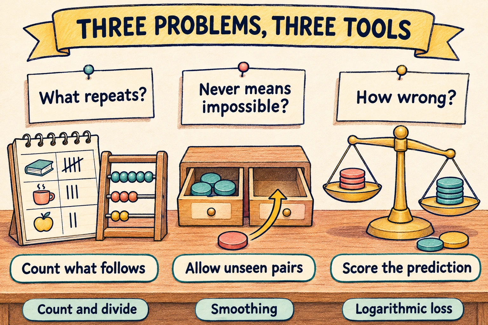
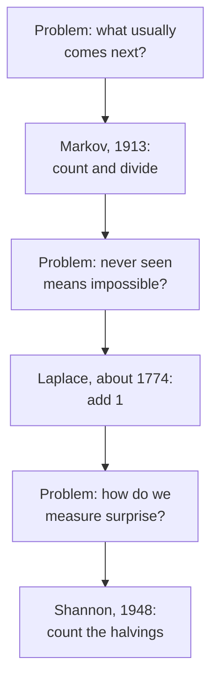
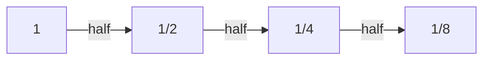
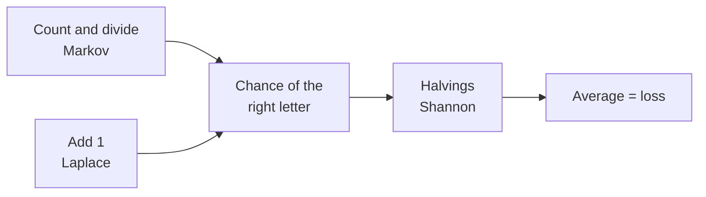

# 8. How people got to the formula



Read the tools from left to right: count repetitions, allow for unseen pairs,
then score predictions. This is our conceptual order, not a historical timeline.

## Think of improving a recipe after each problem

First count what happened. Then notice that "never happened here" shouldn't
mean "impossible". Finally choose a consistent way to score mistakes. These
are three separate needs, which explain the pieces of our formula.

**Where the analogy stops:** this is our teaching order, not a claim that
the historical researchers followed one shared project or modeled a brain.

Nobody wrote it in one go. Each piece fixed a problem left by another.



(Laplace came first in time; Markov's idea comes first in ours.)

## Markov: count and divide

Andrey Markov, a Russian mathematician, took 20,000 letters of a poem and
counted vowels and consonants by hand.

| Previous letter | Chance that the next is a vowel |
| --- | --- |
| vowel | about 13% |
| consonant | about 66% |

So **the letter before changes what comes next**. Our bigram is the same idea
with every letter: `2 / 4`.

## Laplace: add 1

Pierre-Simon Laplace asked: if the sun rose every day so far, what is the
chance it rises tomorrow? Saying 100% is too confident: we can't have seen
everything. His answer was to pretend we saw each outcome once more.

With two outcomes (rises or not), after 9 sunrises in 9 days:
`(9 + 1) / (9 + 2) = 10/11`, about 91%. Our formula does this with 8 outcomes
instead of 2: `(2 + 1) / (4 + 8)`.

## Shannon: measure surprise

Claude Shannon wanted a number for surprise. What should it do?

1. Something certain: surprise **0**.
2. Something rarer: **more** surprise.
3. Two separate surprises: they should **add up**.

Try coins. Each head cuts the chance in half:

| Heads in a row | Chance | Surprise we want |
| --- | --- | --- |
| 0 | 1 | 0 |
| 1 | 1/2 | 1 |
| 2 | 1/4 | 2 |
| 3 | 1/8 | 3 |

So **surprise = how many times you halve 1 to get the chance**. All three rules
work. That operation already had a name: the **logarithm** (base 2).



## Why do we write ln, then?

`ln` is the same measure in another unit, like centimeters and inches.
**One halving = 0.69.**

| Chance | Halvings | × 0.69 | = our loss |
| --- | --- | --- | --- |
| 1/2 | 1 | 0.69 | 0.69 |
| 1/4 | 2 | 2 × 0.693 | 1.39 |
| 1/8 | 3 | 3 × 0.693 | 2.08 |

The last one is our "knows nothing" score, with 8 tokens. Mathematicians like
`ln` because it makes later formulas simpler.

## Put it together



## Python: try it

Calculate the toy 9-out-of-9 example, then express its surprise in both
bits (`log2`) and nats (`ln`).

```python
from math import isclose, log, log2  # Calculate surprise in two different units.

successes = 9  # The example observed nine successes.
trials = 9  # There were nine observations in total.
outcomes = 2  # Allow success and failure, including the unseen outcome.
raw = successes / trials  # Raw counting assigns success a chance of 1.
smoothed = (successes + 1) / (trials + outcomes)  # Add one for each possible outcome.
bits = -log2(smoothed)  # Measure surprise by the base-2 logarithm.
nats = -log(smoothed)  # Measure the same prediction with the natural logarithm.
print(f"Raw: {raw:.2%}; smoothed: {smoothed:.2%}")  # Expect 100% and about 90.91%.
print(f"Bits: {bits:.3f}; nats: {nats:.3f}")  # Different units, same prediction.
assert isclose(nats, bits * log(2))  # One bit equals ln(2) nats.
```

The smoothing rule avoids treating an unseen outcome as impossible.
Changing the logarithm's base changes the unit, not the ordering of predictions.

## Check yourself

The chance is 1/16. How many halvings is that?

<details><summary>Answer</summary>

4: 1 → 1/2 → 1/4 → 1/8 → 1/16.

</details>

Back to the [lesson list](README.md)
