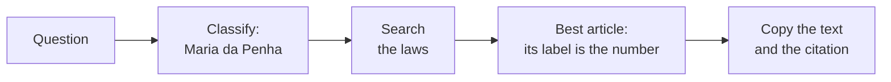
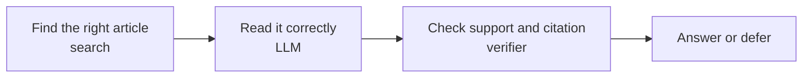

# 9. Where does the article number come from?

## Think of remembering an answer versus checking a book

You might recall an article number confidently and still misremember it.
Opening the source lets you check the number and the wording. Generated
tokens resemble the first activity; retrieval supplies material for the second.

**Where the analogy stops:** weights aren't a reliable catalog of sources,
and finding a real passage doesn't establish that it answers the question.
A supported reasoning chain must also connect its premises to the conclusion.

Question: *"Qual artigo da Lei Maria da Penha trata das medidas protetivas?"*

A language model doesn't look the number up. It guesses likely next tokens.

| | Where the number comes from | Can it be wrong? |
| --- | --- | --- |
| Our bigram | chance of a digit; ignores the question | almost always |
| A large LLM alone | patterns left in its weights by training | yes, and it sounds sure |
| LLM + search (RAG) | the law's text, found first | yes, if the search is wrong |

The LLM alone is an exam **from memory**. RAG is an **open book**.

## What Agavus does

The product answer path doesn't use the lab LLM. Each article is stored with
its number as a label:

## It can still be wrong

When this lesson was written, Agavus answered **art. 10**. The right answer is
**art. 22** (through 24), which the search had placed third. The search
matches words, and art. 10 also says "medida protetiva". It didn't know that
art. 22 is the one that *defines* them.

This second diagram describes an LLM-assisted workflow, not Agavus's current
extractive answer path. If search misses the needed source, later steps need
to detect that and retry or defer. **A real source doesn't guarantee the right answer.**

## Check yourself

An LLM reads the wrong article and explains it perfectly. Which box failed?

Answer

The first: search.

Back to the [lesson list](README.md)
