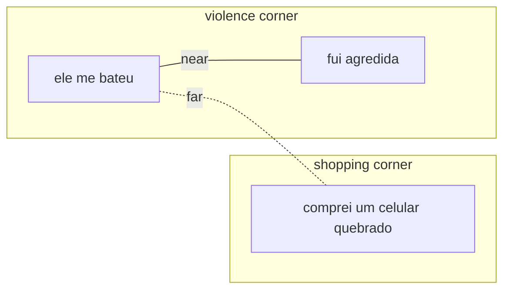
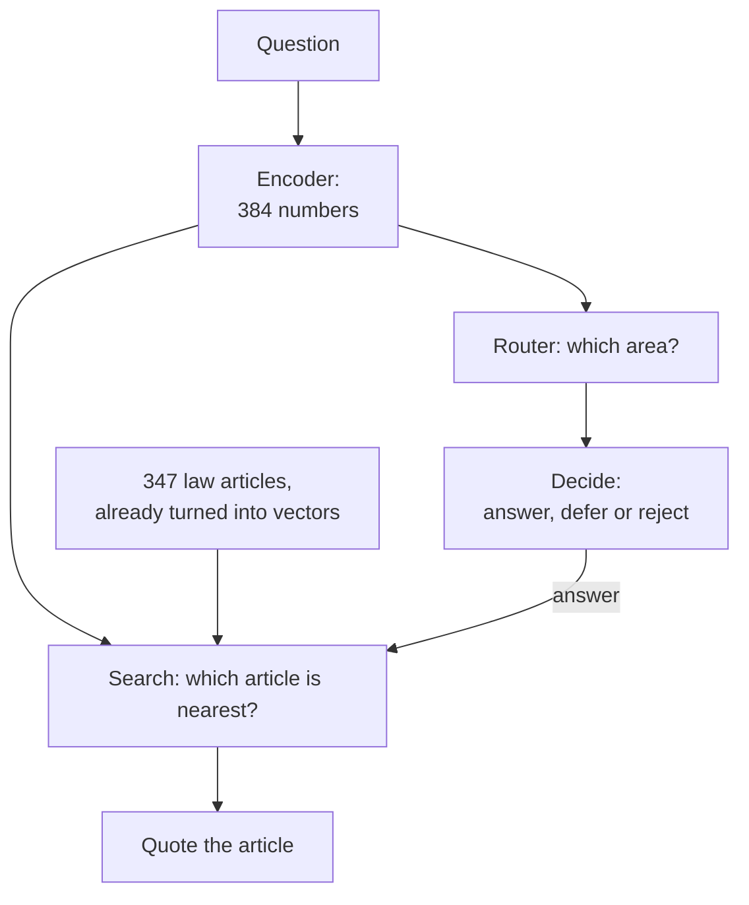

# 10. Embeddings: meaning as a position

In lesson 2, a number was only a **name**: `u` = 7 told us where to look, and
nothing about `u`. Now numbers will carry **meaning**.

## A map of meaning

On a city map, two numbers say where a place is. Places close together on the
map are close in real life.

An embedding does that with texts: **similar meanings get nearby positions.**



"ele me bateu" and "fui agredida" share **no words**. A word search sees
nothing in common. On the map they can be neighbors.

## How many numbers?

A city map needs 2. Ours uses **384** for each text. Nobody can picture that,
but the idea is the same: a position. The list of numbers is a **vector**.

```
"Se minha ex casar de novo..."  ->  0.010  -0.014  -0.046  -0.085  ... (384)
```

One number alone means nothing to us. Only distances between texts do.

## Who drew the map?

A neural network read a huge amount of text and adjusted the positions, again
and again: texts that belong together were pulled closer, others pushed apart.
**We didn't train it.** We use a ready one, `multilingual-e5-small`.

## Measuring closeness

Think of each text as an arrow. Arrows pointing the same way mean similar
things. To compare two arrows (all of length 1): **multiply number by number,
then add**. It's called **cosine similarity**; 1 means the same direction.

A toy with 2 numbers:

| Compare | Calculation | Result |
| --- | --- | --- |
| (1, 0) and (1, 0) | 1×1 + 0×0 | **1.0** same |
| (1, 0) and (0.8, 0.6) | 1×0.8 + 0×0.6 | **0.8** near |
| (1, 0) and (0, 1) | 1×0 + 0×1 | **0.0** unrelated |

With 384 numbers it's the same, only longer.

## Real numbers, real surprise

From the model running in Agavus, compared with "ele me bateu":

| Text | Similarity |
| --- | --- |
| fui agredida pelo meu marido | **0.86** |
| quero dividir a casa no divórcio | 0.84 |
| comprei um celular quebrado | 0.83 |

All are high! This model packs everything into a narrow band. The **order** is
useful; the number itself isn't "86% similar".

## Agavus uses it twice



**The router** learned a weight for each of the 384 numbers, as the old
classifier had one for each word. That stretches out the narrow band:

| Question | F | M | O |
| --- | --- | --- | --- |
| ele me bateu | 0.00 | **0.73** | 0.27 |
| fui agredida pelo meu marido | 0.00 | **1.00** | 0.00 |
| quero dividir a casa no divórcio | **1.00** | 0.00 | 0.00 |
| comprei um celular quebrado | 0.01 | 0.06 | **0.93** |

**The search** keeps the nearest articles:

| Question | Nearest article | |
| --- | --- | --- |
| Quando cessa o dever de alimentos? | Civil Code 1.708 | right |
| Descumprir medida protetiva é crime? | Lei 11.340, 24-A | right |
| Se minha ex casar de novo, paro de pagar pensão? | Civil Code 1.523 | **wrong** (1.708) |

The last one means nearly the same as the first, said in everyday words. The
map got close to *remarriage* and missed *pension ends*. **Near isn't the same
as correct.** (Measured when this lesson was written.)

## Compare with what you know

| | Bigram | Word search | Embedding |
| --- | --- | --- | --- |
| A text is | letter numbers | a bag of words | a position |
| "bateu" and "agrediu" | unrelated | unrelated | can be close |
| Can we see why? | yes, counts | yes, words | **hardly** |

That last row is the price: better results, harder to explain.

An LLM also starts by turning each token into a vector. So you've just met the
first layer of a transformer.

## Check yourself

1. Compute the similarity of (0.6, 0.8) and (1, 0).
2. Two texts score 0.83 in our model. Are they surely about the same thing?

<details><summary>Answers</summary>

1. 0.6×1 + 0.8×0 = **0.6**.
2. No. Even "ele me bateu" and "comprei um celular quebrado" score 0.83. Only
   the order among several texts helps.

</details>

Back to the [lesson list](README.md)
