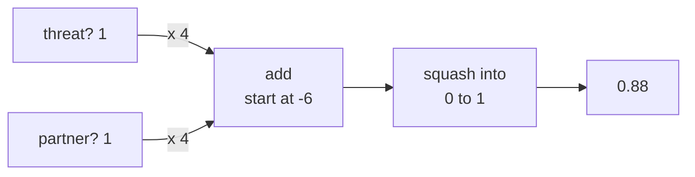
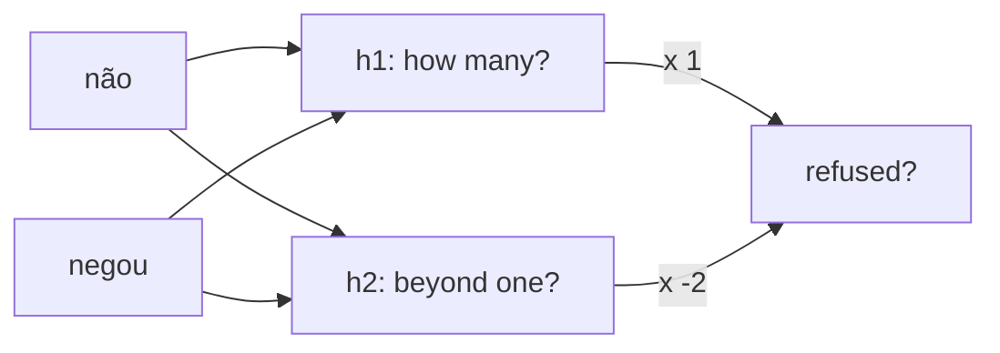
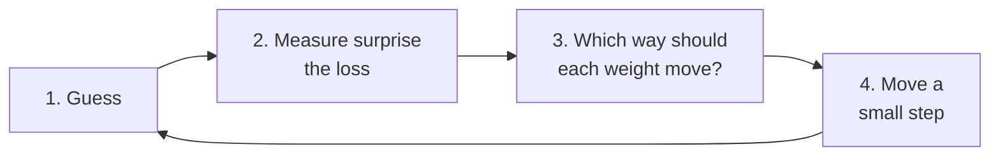

# 11. Neural networks

A neural network is **many tiny calculators connected together**, whose numbers
are found by trial and correction.

## One neuron

A neuron does three things: **multiply, add, squash**.

Question: *is it domestic violence?* It should say yes only if there is a
threat **and** it comes from a partner.

| Threat | Partner | Add up | Squashed |
| --- | --- | --- | --- |
| 0 | 0 | -6 | 0.002 |
| 1 | 0 | 4 - 6 = -2 | 0.12 |
| 0 | 1 | 4 - 6 = -2 | 0.12 |
| 1 | 1 | 4 + 4 - 6 = 2 | **0.88** |

- The **4s** are *weights*: how much each clue matters.
- The **-6** is the *bias*: how hard it is to convince.
- The **squash** turns any number into something like a chance.

You know this one: **it's logistic regression**. Our router is one layer like
this, with 384 inputs and 3 outputs.

## Why is one not enough?

Two negatives cancel in Portuguese. Was the request refused?

| "não"? | "negou"? | Text | Refused? |
| --- | --- | --- | --- |
| 0 | 0 | concedeu | 0 |
| 1 | 0 | não concedeu | 1 |
| 0 | 1 | negou | 1 |
| 1 | 1 | não negou | **0** |

One neuron can only say "more clues, more yes". It can't say "one is yes, but
**two** is no". So we add a layer in between:

`h1 = não + negou`, and `h2 = não + negou - 1`. Negative results become 0.
(That small rule is called **ReLU**.)

| Text | h1 | h2 | h1 - 2 × h2 |
| --- | --- | --- | --- |
| concedeu | 0 | 0 | 0 |
| não concedeu | 1 | 0 | 1 |
| negou | 1 | 0 | 1 |
| não negou | 2 | 1 | 2 - 2 = **0** |

The middle layer **invented a new clue**: "more than one negative". That's the
power of neural networks: they can build their own clues.

Without the ReLU in the middle, two layers would collapse into one: adding and
multiplying twice is still just adding and multiplying.

**"Deep" learning** simply means many layers.

## How does it find the numbers?

Nobody types in the 4s. It starts with poor numbers and repeats:

You know step 2: the loss from lesson 4. Step 3 has a name: the **gradient**.
Imagine walking down a hill in fog. You can't see the bottom, but you feel which
way is down, take a step, and feel again.

A neuron with one weight, where the right answer is 1:

| Step | Weight | Guess | Loss |
| --- | --- | --- | --- |
| 0 | 0.00 | 0.50 | 0.69 |
| 1 | 0.50 | 0.62 | 0.47 |
| 2 | 0.88 | 0.71 | 0.35 |
| 3 | 1.17 | 0.76 | 0.27 |

For this neuron the step is simple: **answer minus guess**. First step:
1 - 0.50 = 0.50, so the weight moves from 0 to 0.50. The better the guess, the
smaller the step.

With many layers, the correction is passed from the end to the start, so every
weight learns its share of the mistake. That's **backpropagation**.

## Counting against learning

| | Bigram | Neural network |
| --- | --- | --- |
| Learns by | counting | guessing and correcting |
| Looks at | 1 letter | as much as we connect |
| Never-seen case | add 1 | uses similar cases |
| Can we see why? | yes | hardly |
| Risk | too simple | memorizing (lesson 5) |

## Where they are in Agavus

| Part | Neural network? |
| --- | --- |
| Router | one layer (logistic regression) |
| Encoder (lesson 10) | yes, deep; trained by others |
| Bigram | no, only counts |
| Tiny GPT we'll build | yes, deep; trained by us |

## Check yourself

1. Weights 4 and 4, bias -6, squash after. Only "threat" is 1. What is the
   number before squashing?
2. Weight 0.50, guess 0.62, right answer 1. What is the new weight?

Answers

1. 4×1 + 4×0 - 6 = **-2**, squashed to 0.12.
2. 0.50 + (1 - 0.62) = **0.88**.

Back to the [lesson list](README.md)
