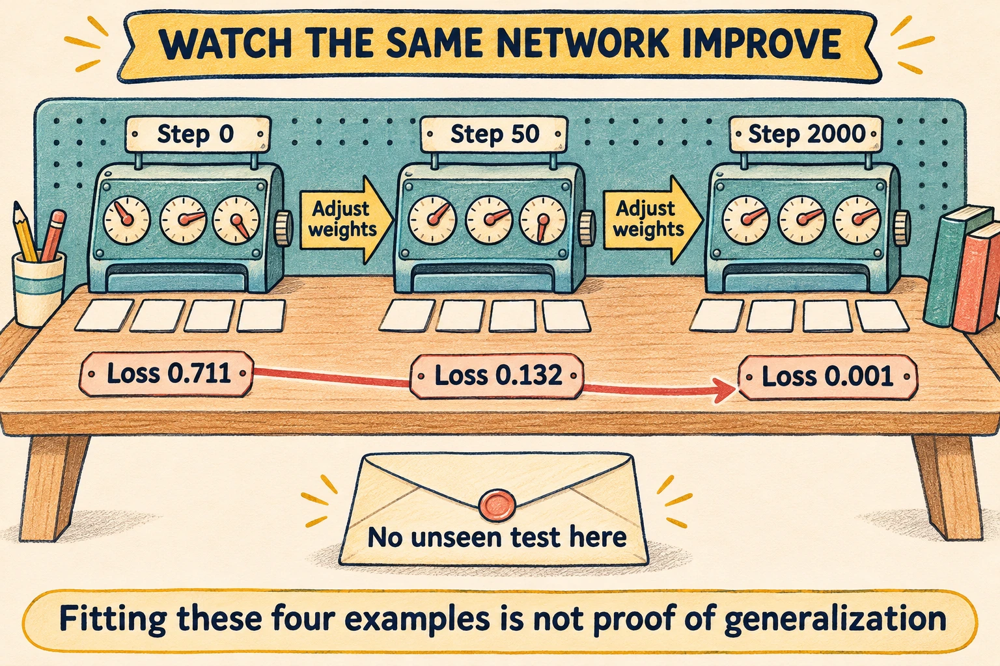
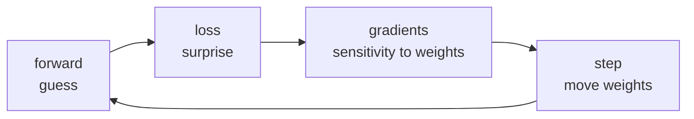

# 12. Watch a network learn



Read the three checkpoints from the recorded example below: loss falls from
0.711 to 0.132 to 0.001. The unopened envelope reminds us there is no unseen test.

## Think of practice with immediate feedback

Try, score the result, adjust, repeat. Here we can watch that loop: `forward`
makes predictions, `loss` scores them, `gradients` calculates sensitivity to
each parameter, and `step` changes the parameters a little.

**Where the analogy stops:** nobody explains the mistake to the network in
words. It receives numerical targets. Solving these four practice examples
doesn't show that it can interpret a new sentence.

Lesson 11 in code. Run it:

```sh
uv run python -m agavus.language_model network
```

The task: *was the request refused?* `negou` is yes, `não negou` is no.

## The loss falls

| Step | 0 | 10 | 50 | 100 | 500 | 2000 |
| --- | --- | --- | --- | --- | --- | --- |
| Loss | 0.711 | 0.512 | 0.132 | 0.038 | 0.003 | 0.001 |

It starts about as unsure as a coin (0.69) and ends nearly certain.

| Text | Answer | One neuron | Network |
| --- | --- | --- | --- |
| concedeu | 0 | 0.50 | **0.00** |
| não concedeu | 1 | 0.50 | **1.00** |
| negou | 1 | 0.50 | **1.00** |
| não negou | 0 | 0.50 | **0.00** |

One neuron gives up and says 50% to everything, as lesson 11 predicted.

## Read the code

`src/agavus/language_model/network.py`, one function per idea:



`gradients` is backpropagation. It's four lines: the mistake at the end, then
each hidden neuron's share of the blame, then each weight's share.

## Three experiments

**1. Luck matters.** It starts from random weights. Out of 100 starts:

| Hidden neurons | 2 | 3 | 4 | 8 |
| --- | --- | --- | --- | --- |
| Solved it | 17 | 46 | 68 | 94 |

Two are enough in theory (we did it by hand), but it often gets stuck. Extra
neurons give it more chances.

**2. The step size matters.** Loss after 200 steps:

| Step size | 0.05 | 0.5 | 5 | 50 |
| --- | --- | --- | --- | --- |
| Loss | 0.365 | **0.012** | 0.693 | 8.114 |

Too small is slow. Too big jumps over the valley.

**3. It has no exam.** All 4 cases were used for training, so this shows it
can *fit*, not that it *generalizes* (lesson 5).

## Python: try it

Use the actual lab network on the four exclusive-or examples. These are
binary logic exercises, not a general parser for Portuguese or legal decisions.

```python
import numpy as np  # Hold the four examples in a small matrix.

from agavus.language_model.network import forward, start, train  # Predict, initialize, and fit.

clues = np.array([[0.0, 0.0], [1.0, 0.0], [0.0, 1.0], [1.0, 1.0]])  # Two flags per row.
answers = np.array([0.0, 1.0, 1.0, 0.0])  # Exactly one active flag means yes.
network = start(hidden=8, seed=0)  # Create eight hidden units from repeatable weights.
# Repeat real forward passes, gradients, and updates using the lab implementation.
trained, losses = train(network, clues, answers, steps=2000, rate=0.5)
guesses = forward(trained, clues).guess  # Predict again with the final weights.
print(f"Loss: {losses[0]:.3f} -> {losses[-1]:.3f}")  # Compare before and after training.
print(np.round(guesses, 2).tolist())  # Expect values close to [0, 1, 1, 0].
assert losses[-1] < losses[0]  # Training should improve this fixed-seed practice score.
```

The score describes the four training examples only. Change the seed or
hidden-unit count to explore why finding a solution isn't guaranteed.

## Check yourself

Why do the weights start random and not all equal?

<details><summary>Answer</summary>

Equal neurons would make the same mistakes, get the same corrections, and stay
equal forever: eight copies of one neuron.

</details>

Back to the [lesson list](README.md)
