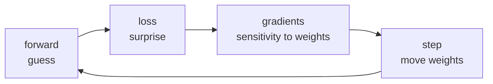

# 12. Watch a network learn

## Think of practice with immediate feedback

Try, score the result, adjust, repeat. Here we can watch that loop: `forward`
makes predictions, `loss` scores them, `gradients` calculates sensitivity to
each parameter, and `step` changes the parameters a little.

**Where the analogy stops:** nobody explains the mistake to the network in
words. It receives numerical targets. Solving these four practice examples
doesn't show that it can interpret a new sentence.

Lesson 11 in code. Run it:

```sh
uv run python -m agavus.lab network
```

The task: *was the request refused?* `negou` is yes, `não negou` is no.

## The loss falls

| Step | 0 | 10 | 50 | 100 | 500 | 2000 |
| --- | --- | --- | --- | --- | --- | --- |
| Loss | 0.711 | 0.512 | 0.132 | 0.038 | 0.003 | 0.001 |

It starts about as unsure as a coin (0.69) and ends nearly certain.

| Text | Answer | One neuron | Network |
| --- | --- | --- | --- |
| concedeu | 0 | 0.50 | **0.00** |
| não concedeu | 1 | 0.50 | **1.00** |
| negou | 1 | 0.50 | **1.00** |
| não negou | 0 | 0.50 | **0.00** |

One neuron gives up and says 50% to everything, as lesson 11 predicted.

## Read the code

`src/agavus/lab/network.py`, one function per idea:



`gradients` is backpropagation. It's four lines: the mistake at the end, then
each hidden neuron's share of the blame, then each weight's share.

## Three experiments

**1. Luck matters.** It starts from random weights. Out of 100 starts:

| Hidden neurons | 2 | 3 | 4 | 8 |
| --- | --- | --- | --- | --- |
| Solved it | 17 | 46 | 68 | 94 |

Two are enough in theory (we did it by hand), but it often gets stuck. Extra
neurons give it more chances.

**2. The step size matters.** Loss after 200 steps:

| Step size | 0.05 | 0.5 | 5 | 50 |
| --- | --- | --- | --- | --- |
| Loss | 0.365 | **0.012** | 0.693 | 8.114 |

Too small is slow. Too big jumps over the valley.

**3. It has no exam.** All 4 cases were used for training, so this shows it
can *fit*, not that it *generalizes* (lesson 5).

## Check yourself

Why do the weights start random and not all equal?

<details><summary>Answer</summary>

Equal neurons would make the same mistakes, get the same corrections, and stay
equal forever: eight copies of one neuron.

</details>

Back to the [lesson list](README.md)
