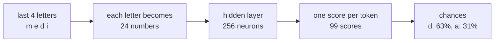
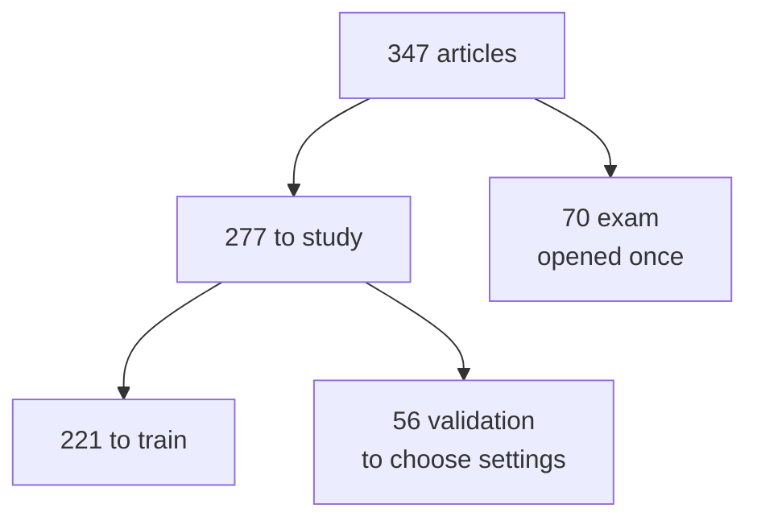

# 13. A neural language model

## Think of using the whole phrase as a clue

One letter leaves many possibilities; `medi` gives a more specific lead.
Instead of a separate tally for every four-letter context, this network
reuses its weights across contexts. It maps the four letters to vectors,
combines them, and produces a score for each possible next token.

**Where the analogy stops:** these four slots aren't human working memory.
They are a fixed input window. During prediction the context changes, while
the trained weights stay fixed; a longer window alone doesn't guarantee improvement.

The bigram counted, and remembered **1** letter. The tiny network learned from
mistakes. Put them together: a network that predicts the next letter from the
last **4**.

```sh
uv run python -m agavus.lab neural
```

## How it works



Each piece is something you know:

| Piece | Lesson |
| --- | --- |
| letters as numbers | 2 |
| a **vector** for each letter (an embedding) | 10 |
| hidden layer, learning from mistakes | 11, 12 |
| chances, loss, sampling | 3, 4, 6 |

This time **we** train the letter vectors, along with everything else: 52,651
numbers in all.

## Why not just count longer?

The bigram's table has 99 × 99 = 9,801 boxes. To count with 4 letters you would
need 99 × 99 × 99 × 99 × 99, about **9.5 billion** boxes. Our 150 KB of law
would leave nearly all of them empty.

The network has no boxes. Similar contexts share the same weights, so what it
learns about one helps with others.

## The exam

| Model | Held-out loss | Like choosing among |
| --- | --- | --- |
| knows nothing | 4.595 | 99 |
| bigram | 2.305 | 10.0 |
| **neural, 4 letters** | **1.364** | **3.9** |

(Smarter ways of counting exist and would also beat the bigram; we haven't
compared with them.)

## Choosing without cheating

How many letters should it see? Trying it on the exam would be cheating
(lesson 5), so we split the study articles again:



| Letters seen | Best validation loss |
| --- | --- |
| 1 | 2.322 |
| 2 | 1.780 |
| **4** | **1.330** |
| 8 | 1.360 |
| 16 | 1.542 |

With 1 letter it's about as good as the bigram (2.347 on the same articles),
which makes sense: it sees the same thing.

More memory stops helping after 4. With 16 letters, training loss fell to
**0.65** while validation rose to **1.67**: that's **overfitting**, and it's
the first time we've seen this gap for real in the neural lab. More suitable
text may help; earlier stopping or a smaller model are other options.

## What it writes

> Art. 15.4.5, particulares do regirá em sito, adminda que contadmanderação ...
> Art. 4. O policial.

| | Sample |
| --- | --- |
| Bigram | Ass cr prece denúntídana elulhe ... |
| Neural | particulares do regirá em sito, adminda que ... |

It has real words now, and starts like an article. It still means nothing, and
"Art. 15.4.5" doesn't exist. **Sounding more like law makes a wrong answer more
dangerous, not less.**

## Check yourself

1. Why does the network not need 9.5 billion boxes?
2. Training loss 0.65, validation 1.67. What happened?

<details><summary>Answers</summary>

1. It computes the chances from shared weights instead of storing every case.
2. Overfitting: it memorized the training text.

</details>

Back to the [lesson list](README.md)
