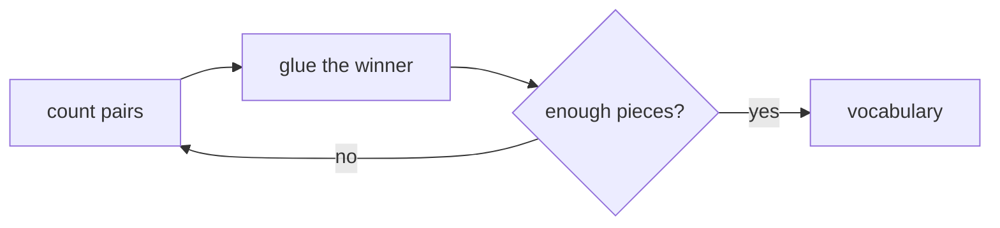

# 14. Word pieces (BPE)

Lesson 2 compared three bricks: letters (too small), words (too many), and
**word pieces**. Now we build the pieces.

```sh
uv run python -m agavus.lab bpe
```

The method is called **byte-pair encoding**, or BPE. It has one rule:

> Find the pair that appears most often. Glue it. Repeat.

## By hand

Text: `guarda guarda guardar` (␣ is a space)

| Glued | Pieces |
| --- | --- |
| nothing | g·u·a·r·d·a·␣·g·u·a·r·d·a·␣·g·u·a·r·d·a·r |
| a + r | g·u·**ar**·d·a·␣·g·u·**ar**·d·a·␣·g·u·**ar**·d·**ar** |
| g + u | **gu**·ar·d·a·␣·**gu**·ar·d·a·␣·**gu**·ar·d·ar |
| ar + d | gu·**ard**·a·␣·gu·**ard**·a·␣·gu·**ard**·ar |
| gu + ard | **guard**·a·␣·**guard**·a·␣·**guard**·ar |
| ␣ + guard | guard·a·**␣guard**·a·**␣guard**·ar |

`guard` came out by itself: the shared root of `guarda` and `guardar`. Nobody
taught it Portuguese. It only counted.



## On the real laws

After 1,000 glues, some words split like this:

| Word | Pieces |
| --- | --- |
| descumprimento | d · es · cum · primento |
| medida protetiva | m · ed · ida · ␣prote · tiv · a |
| guarda | g · uar · da |
| guardar | g · uar · d · ar |

Pieces don't always follow grammar: in the real laws, `guard` wasn't found.
**Frequent is not the same as meaningful.**

The very first piece was `..`! Ten articles contain long rows of dots that
stand for omitted text. BPE learns whatever is there, dirt included.

## Nothing gets lost

We start from **bytes**, the 256 values every file is made of. (`ã` takes two
bytes.) Any text can be split, even `日本語 🙂`, and glued back exactly. No more
"unknown" token needed.

## A fair comparison

Now a token can be several letters. Guessing `␣medida` is harder than guessing
one letter, but it covers seven characters. Comparing loss **per token** would
be unfair, so we divide by characters:

```
loss per character = loss per token x tokens / characters
```

| Model (exam) | Letters | With BPE |
| --- | --- | --- |
| bigram | 2.305 | **1.834** |
| neural, 4 tokens back | 1.364 | **1.340** |

(The bigram used 1,000 glues and the neural model 100, chosen on validation.)

- The **bigram** gains a lot: one token back is now several letters back.
- The **neural** model gains almost nothing. The gap is too small to call a win.

## Why doesn't more help?

Neural model, loss per character:

| Glues | 0 | 100 | 250 | 500 | 1000 |
| --- | --- | --- | --- | --- | --- |
| Training | 1.18 | 0.85 | 0.78 | 0.68 | 0.65 |
| Validation | 1.347 | **1.323** | 1.358 | 1.391 | 1.477 |

Training keeps improving while validation gets worse: overfitting again. More
kinds of brick means fewer examples of each, and we have 150 KB. Real LLMs use
tens of thousands of pieces because they read vastly more text.

## Check yourself

1. Why does BPE find `guard` in our small example?
2. Model A: loss 3.0 per token, 3 characters per token. Model B: 1.5 per
   letter. Which is better?

<details><summary>Answers</summary>

1. Its letters appear together in every word.
2. A: 3.0 ÷ 3 = 1.0 per character, less than 1.5.

</details>

Back to the [lesson list](README.md)
