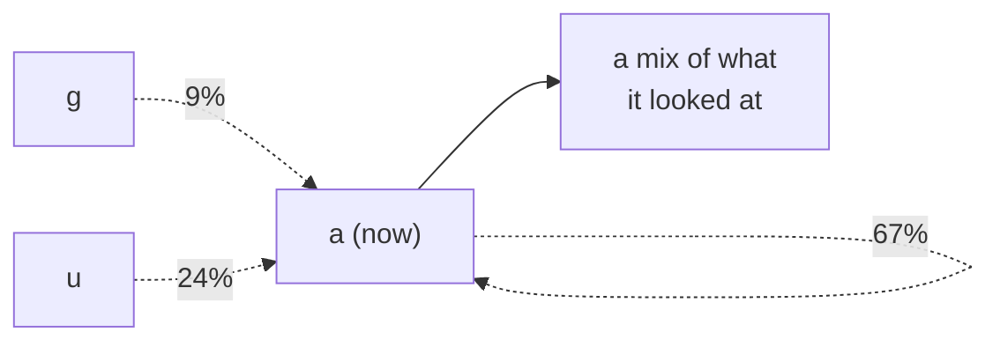

# 15. Attention

The neural model (lesson 13) saw the last **4** letters, always in the same
slots: slot 1, slot 2, slot 3, slot 4. More slots made it worse (overfitting).

But to guess what comes after `violência doméstica e fam`, the useful clue may
be 20 letters back. A GPT keeps a long memory **and lets each letter choose
where to look**. That choice is attention.

## The idea in one picture



The current letter gives each earlier letter a **share** of its attention, the
shares add up to 100%, and it takes a mix of what they offer. It may look at
itself too.

## Three vectors per letter

Every letter turns its vector (lesson 10) into three, each with a job:

| Vector | Question it answers | Like… |
| --- | --- | --- |
| **query** | What am I looking for? | the words you type into a search |
| **key** | What do I contain? | a page's title |
| **value** | What do I hand over if chosen? | the page itself |

They come from three weight tables that training learns, like every other
weight (lesson 12). Nobody tells the model what to look for.

## A worked example

Text `gua`, and `a` is looking back. Two numbers per vector, so you can follow
by hand:

| Letter | key | value |
| --- | --- | --- |
| g | [0, 1] | [1, 0] |
| u | [1, 0] | [0, 1] |
| a | [2, 0] | [1, 1] |

The query of `a` is **[1, 0]**.

**Step 1, match.** Multiply query and key number by number, then add (the dot
product; lesson 10's similarity is this, adjusted for arrow length):

```text
g: 1×0 + 0×1 = 0
u: 1×1 + 0×0 = 1
a: 1×2 + 0×0 = 2
```

**Step 2, shares.** Turn matches into shares that add up to 100%. The rule is
called **softmax**: raise `e` (2.718) to each match, then divide by the total.
Every share comes out positive, and a bigger match always gets a bigger share.
The neural model already used it to turn its scores into chances (lesson 13).

```text
e^0 = 1.00   e^1 = 2.72   e^2 = 7.39     total 11.11
g: 1.00 / 11.11 =  9%
u: 2.72 / 11.11 = 24%
a: 7.39 / 11.11 = 67%
```

**Step 3, mix.** Add the values, each times its share:

```text
0.09 × [1, 0] + 0.24 × [0, 1] + 0.67 × [1, 1] = [0.76, 0.91]
```

That new vector is what `a` "learned" from its past. That's all attention is:
**match, shares, mix**.

(The real model also divides the matches by the square root of the vector size,
so long vectors don't give huge matches and 100% to one letter.)

## No peeking at the future

While training, the model sees the whole sentence at once. If a letter could
look ahead, it would just read the answer: that's cheating, like seeing the
exam (lesson 5).

So before the softmax, the matches with later letters are set to **minus
infinity**. `e^(-∞) = 0`, so they get a 0% share:

| looks at → | g | u | a | r |
| --- | --- | --- | --- | --- |
| **g** | 100% | 0 | 0 | 0 |
| **u** | ✓ | ✓ | 0 | 0 |
| **a** | ✓ | ✓ | ✓ | 0 |
| **r** | ✓ | ✓ | ✓ | ✓ |

This is why a GPT can learn from every letter of a text in one go: each row is
its own little "guess the next letter" exercise.

## Where am I?

Attention only compares contents, so on its own `ag` and `ga` would look the
same. So each **position** also gets a learned vector, added to the letter's
vector. Now "an `a` right before me" and "an `a` far back" are different.

## Several heads

One query can only look for one thing. So the model asks several questions at
once, each with its own query, key and value tables: these are **heads**. Ours
has 4. One may learn to look at the previous letter, another at the start of
the word. We'll print what they look at in the next lesson.

## Check yourself

1. Matches are 0, 0 and 0. What are the shares?
2. Why must a letter never look at later letters while training?
3. Without position vectors, what can attention not tell apart?

<details><summary>Answers</summary>

1. 33% each: `e^0 = 1` for all three, so they split evenly.
2. The next letter is the answer; seeing it is cheating.
3. Order: `ag` and `ga` would look the same.

</details>

Next: [16. A tiny GPT](16-a-tiny-gpt.md). Back to the [lesson list](README.md)
