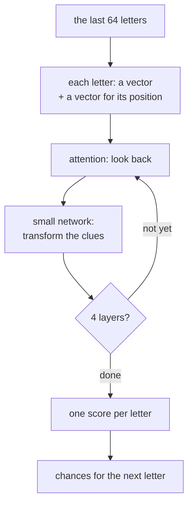

# 16. A tiny GPT

## Think of making several passes over your notes

On one pass you gather clues; on another you combine them into something
more useful. Each transformer layer mixes context through attention, then
transforms each position's vector with a small network. Four layers mean
four successive transformations of the representations.

**Where the analogy stops:** layers aren't conscious thinking stages or
written reasoning steps. This GPT is trained to predict letters. A lower loss
doesn't establish that a generated claim follows from cited evidence.

Attention (lesson 15) is the new idea. A GPT is attention plus pieces you
already know, stacked a few times.

```sh
uv run python -m agavus.lab gpt
```

(About 15 minutes on our CPU, with 4 threads. This is the first lab model where
a GPU would really help.)

## The whole model



| Piece | What it does | Lesson |
| --- | --- | --- |
| letter + position vectors | numbers that carry meaning and order | 10, 15 |
| attention, 4 heads | each letter gathers clues from earlier letters | 15 |
| small network (128 → 512 → 128) | transforms the gathered representation | 11, 13 |
| repeat 4 times | later layers build on earlier ones | new |
| scores → chances → loss | the same as every model before | 4, 13 |

"GPT" means **G**enerative **P**re-trained **T**ransformer. *Transformer* is the
name of this stack of attention + network layers. Real GPTs are this, much
bigger: more layers, wider vectors, many more heads, and vastly more text.

## Three small helpers

These don't change *what* the model can do; they make training work.

**Add, don't replace.** Each layer *adds* its result to the letter's vector
instead of overwriting it. If a layer has nothing useful to say, the vector
passes through untouched. Without this, deep stacks barely learn.

**Keep the numbers steady.** Before each step, the vector is rescaled so its
numbers average 0 and spread about 1 (layer norm). Otherwise numbers can grow
or shrink layer after layer.

**Switch some neurons off.** While training, 20% of the numbers are randomly
set to zero each step (dropout). The model can't rely on any one of them, so
it memorizes less. At the exam, nothing is switched off.

## Choosing the size, on validation

Same rule as always: settings are chosen on validation articles, and the exam
is opened once (lesson 5).

| Size | Numbers learned | Dropout | Best validation |
| --- | --- | --- | --- |
| 2 layers, 64 wide | 116 thousand | none | 1.259 |
| 2 layers, 64 wide | 116 thousand | 10% | 1.180 |
| 2 layers, 64 wide | 116 thousand | 20% | 1.204 |
| 4 layers, 128 wide | 823 thousand | 10% | 1.160 |
| **4 layers, 128 wide** | **823 thousand** | **20%** | **1.123** |

Two things to see:

- **Dropout helps a lot.** Without it, the small model's validation loss bottoms
  out at 1.259 and then gets worse while training loss keeps falling:
  memorizing.
- **The bigger model only wins with more dropout.** It has more room to
  memorize, so it needs more holding back.

## The exam

| Model | Exam loss, per letter | Like choosing among |
| --- | --- | --- |
| knows nothing | 4.595 | 99 |
| bigram (1 letter back) | 2.305 | 10.0 |
| neural (4 letters back) | 1.364 | 3.9 |
| **tiny GPT (64 letters back)** | **1.181** | **3.3** |

Same letters, same articles, same exam: the comparison is fair. Training
stopped at step 3,500, where validation was lowest.

But look at training: **0.87**, against 1.18 on the exam. On validation the
gap opened early (step 3,500: 0.78 vs 1.11) and kept growing. The model still
memorizes; it just memorizes *usefully* for longer.

## What it writes

> Art. 1.577. A nua contra ao plicadome de da, quando houverem da convivência
> familiar em outro.

> Art. 15º A administração dos bens que ao coubenssidente poderá mítulo vida
> antecedente se em sobrigação ...

| Model | Sample |
| --- | --- |
| bigram | Ass cr prece denúntídana elulhe ... |
| neural | particulares do regirá em sito, adminda que ... |
| tiny GPT | A administração dos bens ... quando houverem da convivência familiar |

Longer stretches are real Portuguese, with law-like phrases ("convivência
familiar", "administração dos bens"). It still means nothing. "Art. 1.577"
does exist in the Civil Code, but this text isn't it: the model has learned
what a citation **looks** like, not what it says. This is exactly why agavus
answers with quoted excerpts and never with generated text.

## What the heads look at

Nobody told the heads what to look for. On `… violência doméstica`, the last
`a` looks at:

| Head (last layer) | Looks at | Share |
| --- | --- | --- |
| 0 | the space before `doméstica`: **where the word starts** | 99% |
| 1 | itself | 41% |
| 2 | the `é` inside the same word | 100% |
| 3 | the letters just before: `c`, `i` | 62%, 28% |

And across all letters, on average:

| Layer | Looks back about |
| --- | --- |
| 1 | 1 letter |
| 2, 3 | 3–6 letters |
| 4 | 4–9 letters |

The first layer looks close by; later layers look further, building on what
the first one gathered. Don't read too much into one sentence, but this
pattern, near first and far later, is common in real models too.

## Check yourself

1. A layer adds its result to the vector instead of replacing it. What
   happens if a layer learns nothing useful?
2. Why is dropout turned off during the exam?
3. Training loss 0.60, validation 1.14. Is the model memorizing?

<details><summary>Answers</summary>

1. The vector passes through unchanged, so that layer does no harm.
2. The exam should measure the whole model; dropout is only a training
   handicap to stop memorizing.
3. That gap suggests overfitting on a comparable split. Try earlier stopping,
   regularization, or more suitable text; increasing size alone may worsen it.

</details>

Next: [17. More text](17-more-text.md). Back to the [lesson list](README.md)
