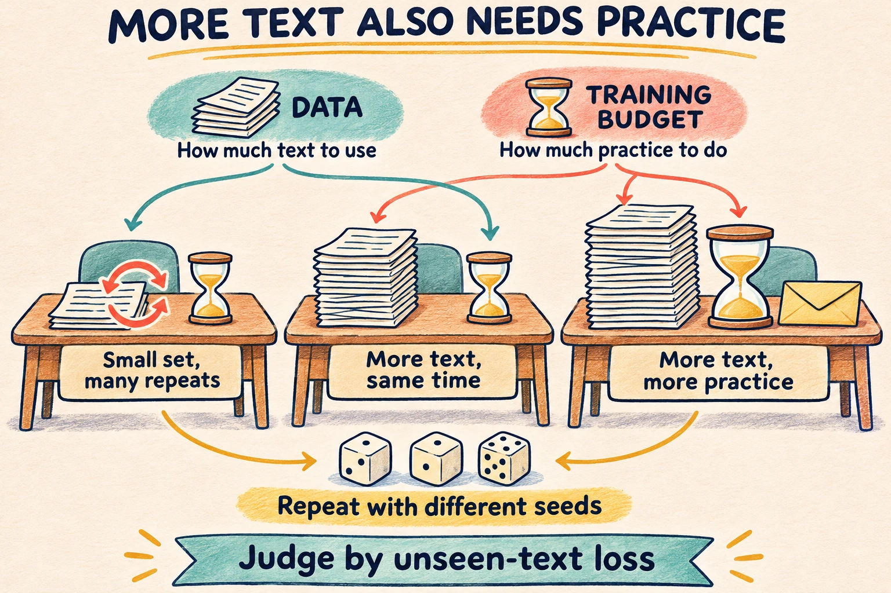

# 17. More text



More pages and more training time are separate choices. Compare unseen-text
loss and repeat with different seeds before calling a setup better.

## Think of broadening your practice questions

Practising varied examples can help you rely less on a particular answer.
But a language exam won't necessarily improve because you spend the same
study time on a different subject. More text changes both what the model
practises and how often it revisits each example.

**Where the analogy stops:** the model doesn't choose a study strategy.
We choose the data, steps, and stopping point. A smaller training–exam gap
can also mean worse training performance; compare the exam scores themselves.

Agathe (lesson 16) memorized: loss 0.87 on the articles it studied, 1.18
on the exam. The usual cure is more text. So we tried three kinds.

```sh
uv run python -m agavus.model fetch-wikipedia   # once
uv run python -m agavus.model agathe civil         # or: agathe wikipedia, agathe civil wikipedia
```

## Where the text came from

| Text | Size | Style | License |
| --- | --- | --- | --- |
| our statute articles | 148 KB | law | public domain |
| **rest of the Civil Code** (everything outside the family book) | 524 KB | law | public domain |
| **Wikipedia**, opening of 350 articles | 485 KB | encyclopedia | CC BY-SA 4.0 |

Laws aren't protected by copyright in Brazil (Lei 9.610/1998, art. 8º, IV).
Wikipedia lets anyone reuse its text if they credit it, so we keep each
article's link. Nothing we train is published.

## Keeping the exam fair

Three rules, so the new scores compare with the old ones:

1. Extra text only goes to the **study** side. Validation and the exam are the
   same statute articles as before.
2. The **alphabet** stays the statute one (99 tokens). A letter it doesn't
   know (0.45% of Wikipedia) becomes "unknown".
3. **No leaks.** Any extra text that shares 100 letters in a row with one of our
   347 articles is dropped. One Civil Code article was (art. 4º).

Same model, same 6,000 training steps for every run.

## The results (one run each, on CPU)

| Study text | Exam | Studied articles | Gap |
| --- | --- | --- | --- |
| statutes only | 1.181 | 0.87 | 0.31 |
| + Civil Code | 1.174 | 1.06 | 0.11 |
| + Wikipedia | 1.289 | 1.21 | 0.08 |
| + both | 1.276 | 1.21 | 0.06 |

"Studied articles" is the loss on the statute articles it trained on. The
**gap** is how much better it does on text it saw than on text it didn't:
one indication of overfitting when the text distributions are comparable.

**More text reduced the measured gap here.** It fell from 0.31 to 0.11, and
0.06 with both. But the exam got worse with Wikipedia: a smaller gap alone
doesn't prove better generalization or eliminate memorization.

**The kind of text matters.** Wikipedia made the exam worse despite reducing
the gap. Its steps include encyclopedia prose rather than only legal writing
such as "§ 1º" and "parágrafo único".

## Is 1.174 really better than 1.181?

It looked like the Civil Code helped a little. So we rented a GPU (an RTX 3070,
R$ 1.03 for the session) and trained the same models again with different
**seeds**. The seed decides the random parts: the starting weights, which
windows are read, which numbers dropout switches off.

| Seed | Statutes only | + Civil Code |
| --- | --- | --- |
| 0 (GPU) | 1.162 | 1.226 |
| 1 | 1.169 | 1.171 |
| 2 | 1.161 | 1.192 |
| **average** | **1.164** | **1.196** |

The same model, the same text, and only luck changes: the Civil Code runs vary
by **0.05**. Our apparent gain of 0.007 wasn't reliable evidence. On average
in these three runs, at 6,000 steps, the Civil Code is slightly **worse**.

**Never trust one run.** Before saying "B beats A", repeat both with a few
seeds and check that the difference is bigger than the spread.

## Then why add text?

6,000 steps of 32 windows of 64 letters is about 12 million letters read. Over
our ~120 KB of study articles, that's about 100 readings of each letter; over
the Civil Code mix (~640 KB), only about 19. With more text the model needs
more training, and validation was still improving at the last step. So on the
GPU we let it train 5× longer:

| Step | 6,000 | 10,000 | 16,000 | 21,000 | **26,000** | 30,000 |
| --- | --- | --- | --- | --- | --- | --- |
| Validation, + Civil Code | 1.169 | 1.113 | 1.090 | 1.077 | **1.057** | 1.062 |

| Setup | Exam |
| --- | --- |
| statutes only (stops improving near step 5,000) | 1.164 |
| + Civil Code, 6,000 steps | 1.196 |
| **+ Civil Code, 26,000 steps** | **1.093** |

About 0.07 better than the statutes-only average: a promising result, but the
longer run used only one seed. Repeat the longer setup before claiming a
reliable win. The statutes-only runs stopped improving earlier (lesson 16).
**More text and more training, together**, helped this run; data quality,
model size, and evaluation still matter.

The GPU took 6.4 minutes for a run that took about 16 on our CPU. The model is
so small that the GPU sat mostly idle (about 12% busy); bigger models are
where it shines.

## Python: try it

Use a budget calculation and the **recorded** seed scores from the table.
This analyzes those results rather than starting a new training run.

```python
from statistics import mean  # Average the recorded results across seeds.

steps = 6000  # Use the same update budget as the short runs.
batch = 32  # Each update reads 32 windows.
context = 64  # Each window contributes 64 next-character training targets.
targets_seen = steps * batch * context  # Count target presentations, including repeats.
small_size = 120_000  # Approximate number of training characters in the small set.
large_size = 640_000  # Approximate size after adding the other Civil Code articles.
print(targets_seen / small_size)  # About 102 presentations per small-set character.
print(targets_seen / large_size)  # About 19 presentations per larger-set character.
statutes = [1.162, 1.169, 1.161]  # Copy the three recorded statutes-only GPU exam losses.
civil = [1.226, 1.171, 1.192]  # Copy the three recorded mixed-text exam losses.
print(f"Statutes mean: {mean(statutes):.3f}")  # Expect 1.164.
print(f"Mixed mean: {mean(civil):.3f}")  # Expect 1.196; lower would be better.
print(f"Mixed spread: {max(civil) - min(civil):.3f}")  # About 0.055 across these seeds.
```

The presentation counts are rough averages, not literal full passes through
the data. Change `steps` to 30000; the recorded losses won't change automatically.

## Check yourself

1. Why must the extra text never contain an exam article?
2. Gap 0.31 before, 0.11 after. What changed in how the model learns?
3. Model A scores 1.17, model B 1.18, from one run each. Is A better?
4. Validation is still falling at the last step. What would you try next?

<details><summary>Answers</summary>

1. The model would have studied the answers; the exam would measure memory, not
   learning.
2. The measured gap shrank. With fixed steps it revisits each article less,
   but check exam loss too before claiming that generalization improved.
3. You can't tell. Repeat both with a few seeds; one run can be off by 0.05.
4. Train longer (more steps). With the Civil Code, that took the exam from
   1.196 to 1.093.

</details>

Back to the [lesson list](README.md)
