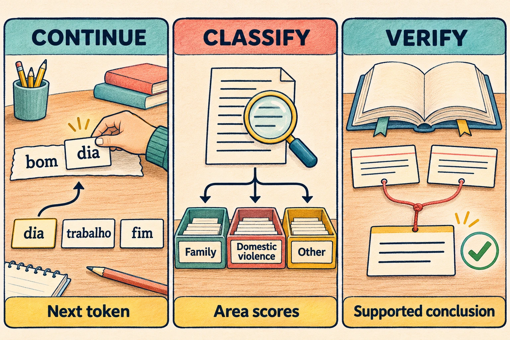

# Learning: from counting letters to an LLM

Short lessons. One idea each, one tiny example: the text `guarda guarda`.
Read in order, and stop whenever something is unclear.

## Start with a familiar experience

Think of learning a new language: you notice recurring pieces, try an answer,
get feedback, and practise on new examples. That gives us a way into the math.
Each lesson opens with its own illustration and caption, then connects an
analogy to the model's actual numbers and explains its limit. Use the picture
to ask **what goes in, what changes, and what comes out?**

Read the picture first, then trace the example in the text. The
[illustration index](illustrations/README.md) links to every image at full size.

These are comparisons with familiar activities, not explanations of how brains
work. A model's "neuron" is a calculation; "attention" is a weighted mixture.
Neither word establishes human awareness or human reasoning.

## Three different jobs



The three desks show different outputs: a next token, area scores, and a
conclusion supported by premises. None of these outputs establishes the other two.

| Job | Familiar activity | Input → output |
| --- | --- | --- |
| Classification | sorting into trays | text → area probabilities |
| Language modeling | completing a sentence | context → next-token probabilities |
| Verified reasoning | checking cited premises | facts + rules + sources → chain or defer |

Agavus has a TF-IDF classifier; its query router uses encoder vectors and
learned weights. The isolated lab builds a bigram, a neural language model,
and a tiny GPT. The product's `reason/` package checks supported chains;
`answer/` delivers cited excerpts.

Predicting a likely continuation doesn't verify its truth. Choosing an area
doesn't establish the facts of a case. Agavus also has a separate decision
step: accept, reject, or defer according to uncertainty and error costs.

**Training** changes the counts or weights using examples. **Inference** uses
what was learned to make a prediction. Reading a prompt changes the context;
it doesn't update our lab network's weights. See the [lab rules](../docs/llm-lab.md)
and [product design](../docs/DESIGN.md) for the boundary between them.

Read each worked example, then try its **Check yourself** before opening the
answer. If a formula feels abstract, describe what its numbers stand for first.

```mermaid
flowchart LR
  A["1. Guess the<br/>next letter"] --> B["2. Letters<br/>become numbers"]
  B --> C["3. Learn by<br/>counting"]
  C --> D["4. Score<br/>the guesses"]
  D --> E["5. Use an<br/>exam"]
  E --> F["6. Write<br/>new text"]
  F --> G["7. The math"]
  G --> H["8. Where it<br/>came from"]
  H --> I["9. Finding<br/>the article"]
  I --> J["10. Meaning as<br/>a position"]
  J --> K["11. Neural<br/>networks"]
  K --> L["12. Watch<br/>it learn"]
  L --> M["13. Neural<br/>language model"]
  M --> N["14. Word<br/>pieces"]
  N --> O["15. Attention"]
  O --> P["16. A tiny<br/>GPT"]
  P --> Q["17. More<br/>text"]
```



| Lesson | Question it answers |
| --- | --- |
| [1. Guess the next letter](01-guess-the-next-letter.md) | What does a language model do? |
| [2. Letters become numbers](02-letters-become-numbers.md) | Why pieces and numbers? |
| [3. Learn by counting](03-learn-by-counting.md) | How does our model learn? |
| [4. Score the guesses](04-score-the-guesses.md) | What is "loss"? |
| [5. Use an exam](05-use-an-exam.md) | Did it learn, or memorize? |
| [6. Write new text](06-write-new-text.md) | How does a model write? |
| [7. The math](07-the-math.md) | Where does each number come from? |
| [8. How people got there](08-how-they-got-there.md) | Why this formula? Try before 7. |
| [9. Article numbers](09-where-does-the-number-come-from.md) | Why that number? |
| [10. Embeddings](10-embeddings.md) | How can numbers carry meaning? |
| [11. Neural networks](11-neural-networks.md) | How does a machine find its own clues? |
| [12. Watch it learn](12-watch-it-learn.md) | What does training look like? |
| [13. Neural language model](13-a-neural-language-model.md) | What if it sees more letters? |
| [14. Word pieces](14-word-pieces.md) | Why not letters or whole words? |
| [15. Attention](15-attention.md) | How does the model gather context? |
| [16. A tiny GPT](16-a-tiny-gpt.md) | What is a GPT, piece by piece? |
| [17. More text](17-more-text.md) | Does more text help, and which text? |

Run the real thing at any time:

```sh
uv run python -m agavus.lab
```
