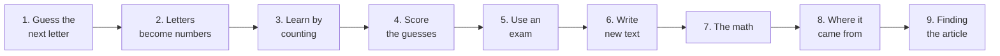

# Learning: from counting letters to an LLM

Short lessons. One idea each, one tiny example: the text `guarda guarda`.
Read in order, and stop whenever something is unclear.



| Lesson | Question it answers |
| --- | --- |
| [1. Guess the next letter](01-guess-the-next-letter.md) | What does a language model do? |
| [2. Letters become numbers](02-letters-become-numbers.md) | Why split the text, and why use numbers? |
| [3. Learn by counting](03-learn-by-counting.md) | How does our model learn? |
| [4. Score the guesses](04-score-the-guesses.md) | What is "loss"? |
| [5. Use an exam](05-use-an-exam.md) | Did it learn, or memorize? |
| [6. Write new text](06-write-new-text.md) | How does a model write? |
| [7. The math](07-the-math.md) | Where does each number come from? |
| [8. How people got there](08-how-they-got-there.md) | Why is the formula like that? Read before 7 if 7 is hard. |
| [9. Where the article number comes from](09-where-does-the-number-come-from.md) | How does it know "art. 22"? |

Run the real thing at any time:

```sh
uv run python -m agavus.lab
```
